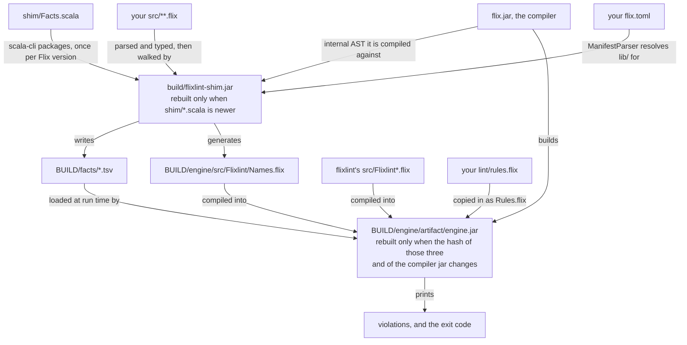
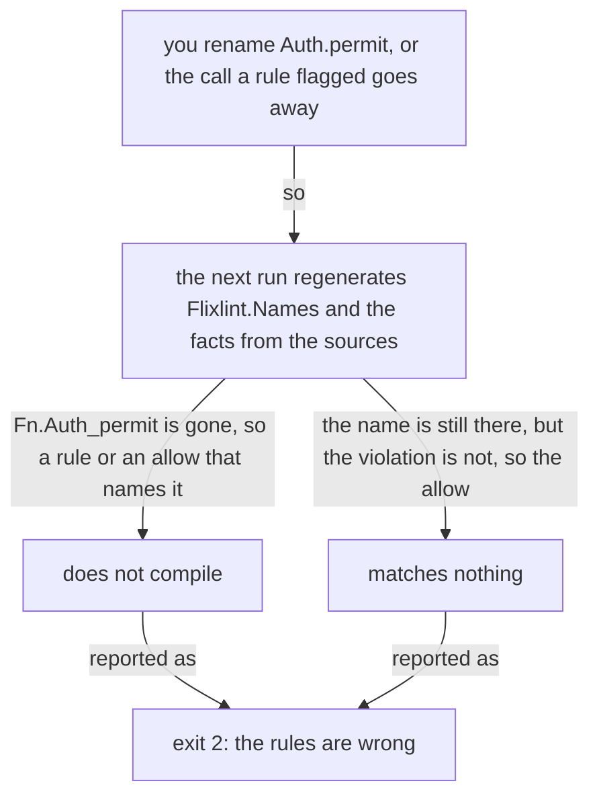
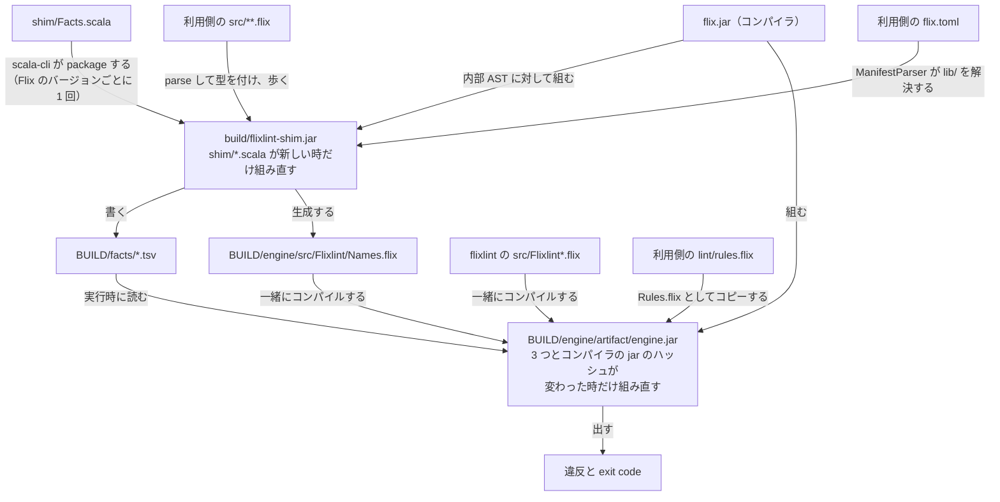
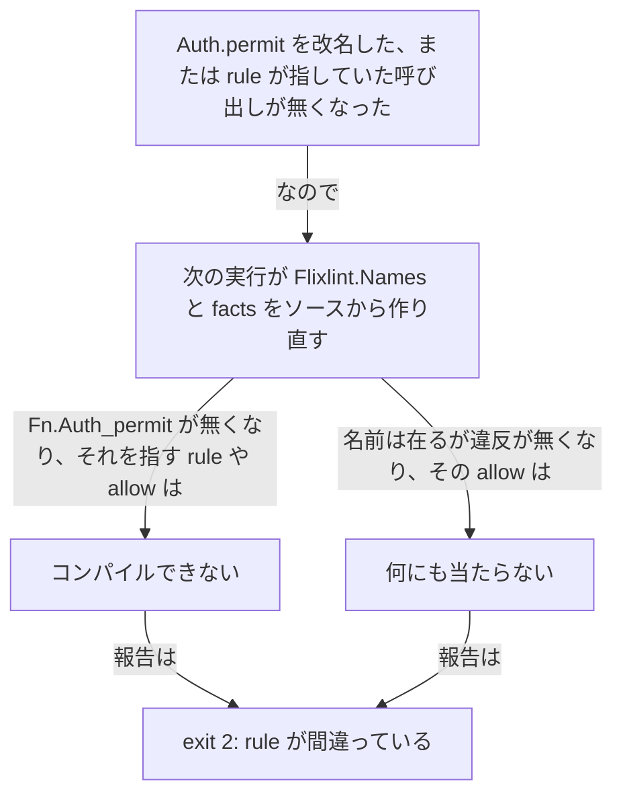

# flixlint

*日本語版はこのページの[下半分](#flixlint日本語)にあります。英語版が正。*

Architecture rules for [Flix](https://flix.dev) projects, checked on the compiler's AST instead of with `grep`.

The compiler already builds a typed AST of the whole project; flixlint asks it for a handful of language-level
**facts** (which function is defined where, who calls whom, which effects a signature has, where a handler is
installed, which enum case is built where, what the types of a signature are made of, which lambda a call sits in, which
literal or call is an argument, what a `|>` chain passes along) and writes them as TSV. Rules are written in
Flix, as records in the style of Clippy's `clippy.toml`: one entry says what is disallowed, why, and which functions
are allowed anyway. The names of functions, effects, modules, cases, enums and types are enums generated from the
facts, so a rule that names something the sources no longer have does not compile, and an allow that no longer covers
anything is an error.

flixlint knows nothing about any particular project: the names of effects, modules, files and enum cases are the
rules' business, not the linter's.



`bin/flixlint` drives all of this: the shim walk runs on every lint, the two jars are rebuilt only when what they are
keyed on changed, and `BUILD` is `--build-dir` (default `build/flixlint`).

## Installing

flixlint is a **tool**, not a Flix library: it is delivered as this repository, and a project that wants to be linted
calls `bin/flixlint`. It is deliberately not something you put in your `flix.toml` `[dependencies]` — see
[Why it is not an fpkg](#why-it-is-not-an-fpkg).

```bash
# next to the project that will be linted, or anywhere else
git clone https://github.com/ababup1192/flixlint.git
# or, inside the project:
git submodule add https://github.com/ababup1192/flixlint.git flixlint
```

The project to lint is an ordinary Flix project; an empty one is `java -jar flix.jar init` in an empty directory.

You need a JDK and the Flix compiler jar of the version in `flix.toml` (`flix = "0.78.0"`). Download `flix.jar`
from [Flix's GitHub releases](https://github.com/flix/flix/releases) and pass it with `--flix-jar` or `FLIX_JAR`;
with neither, `bin/flix-jar` takes the `share/java/flix/flix.jar` next to the `flix` on `PATH`.

The Scala shim is built once, on first use and whenever `shim/*.scala` changes, into `build/flixlint-shim.jar`.
That needs `scala-cli`: `devbox.json` has it, and a `scala-cli` on `PATH` is used when there is no devbox. If you
have neither, take `flixlint-shim-<flix version>.jar` from the release and pass it with `--shim` or `FLIXLINT_SHIM`
(`make release` is what attaches it). The jar holds only flixlint's own classes, compiled against the compiler's
internal AST, so one jar per Flix version serves every machine and every project.

```bash
make test            # lint test/fixture and examples/, diff the reports against test/expected*.txt
make test-resolved   # the same at the resolved stage
make shim            # rebuild build/flixlint-shim.jar
```

`make test` is also the type check of the rule engine: `src/Flixlint*.flix` only compiles together with a generated
`Names.flix`, so running a project through is the only way to compile it. This repository therefore has no
`flix check` of its own — `test/` holds a fixture that must not compile (`rules/broken.flix` names a function the
sources do not have), which is exactly what the test asserts.

## Using it from your project

Keep one file in your project — the rules — and call flixlint with the compiler jar:

```make
lint:
	../flixlint/bin/flixlint --flix-jar /path/to/flix.jar --rules lint/rules.flix --stage resolved src
```

| What | Where | Committed |
|---|---|---|
| the rule file | anywhere; `--rules` names it (`lint/rules.flix` here) | yes, it is your architecture |
| the call | a `lint` target, and the same line in CI | yes |
| flixlint itself | a clone anywhere, or a submodule in the project | the submodule, if you take one |
| the facts, the generated `Names.flix`, the rule engine and its jar | `--build-dir` (default `build/flixlint`) | no, `.gitignore` it |
| the shim jar | flixlint's own `build/`, or wherever `--shim` points | no |

When neither `--pkg` nor `--jar` is given, the shim reads your `flix.toml` with
the compiler's own `ManifestParser` and passes the versions it names out of `lib/`, where the compiler has unpacked
them: `lib/github/<owner>/<name>/<version>/` for a Flix package (its own manifest is read there too, so a package's
own dependencies come along), `lib/external/` for a `[jar-dependencies]` jar, and every jar under `lib/cache/` for
`[mvn-dependencies]`. Nothing is downloaded. The project is the nearest directory with a `flix.toml` at or above the
sources, never above the current directory; `--project-root DIR` names it when that is not where it is. A project
with no dependencies gets nothing, and `--pkg` / `--jar` override the whole thing. The packages do
have to be unpacked: one that `flix.toml` names and `lib/` does not have is exit 4, with the message to run
`flix check` once; if you pass `--pkg` / `--jar` yourself and miss one, the sources do not compile and it is exit 3.

Your rule file names things through the generated module, so it starts with
`use Flixlint.Names.{Fn, Eff, Mod, Case, Enum, Type}`.

### Why it is not an fpkg

`flix build-pkg` puts `flix.toml`, `README.md`, `LICENSE.md` and `src/**/*.flix` into the package and nothing else —
a jar or a resource file under `src/` is dropped, and so is everything outside `src/`. So neither `bin/flixlint` nor
the shim jar can travel in an fpkg. On top of that, `src/Flixlint*.flix` refers to the generated `Flixlint.Names`
module, so
as a package it would not compile in the consumer's project at all — and it has no business being compiled into the
consumer's program, since only the throwaway rule-engine project that `bin/flixlint` generates ever uses it.

Flix does have `[jar-dependencies]` (`"name.jar" = "url:https://..."`, downloaded into `lib/external/`), and it is
applied to transitive manifests too, but it delivers a jar to the consumer's *compile* classpath, which is not where
the shim runs: the shim runs on the compiler jar's classpath inside `bin/flixlint`. Hence the release asset.

## Usage

```
bin/flixlint [--flix-jar JAR] --rules PATH/rules.flix [--pkg FPKG]... [--jar JAR]... [--stage typed|resolved]
             [--today YYYY-MM-DD] [--limits FILE.json|DIR [--limits-base FILE.json|DIR]] [--facts-out DIR] [--build-dir DIR] [--project-root DIR] [--shim JAR]
             [--java-opts "..."] [--spans FILE] [--resident [--heap-mb N] [--idle-minutes N] [--run-limit SECONDS]] [--timeout SECONDS] SRC...
bin/flixlint --resident-stop [--flix-jar JAR] [--shim JAR]
bin/flixlint --socket-name ROOT IDENTITY
bin/flixlint [--flix-jar JAR] --spans FILE [--stage typed|resolved] [--pkg FPKG]... [--jar JAR]... [--project-root DIR] SRC...
bin/flixlint --version
```

| Option | Meaning |
|---|---|
| `--flix-jar JAR` | The Flix compiler (`flix.jar`, 0.78.0). `FLIX_JAR` in the environment works too; with neither, `bin/flix-jar` resolves it. |
| `--rules PATH/rules.flix` | The rule file: a Flix module with `pub def rules(): Flixlint.RuleSet` (see below). |
| `--pkg FPKG` / `--jar JAR` | Dependencies the sources need (`lib/github/<owner>/<name>/<version>/<name>-<version>.fpkg`, `lib/cache/**/*.jar`). Repeatable. A package is named after that path (Flix 0.78 mounts packages by id). With neither, they are read from the project's `flix.toml`. |
| `--project-root DIR` | The directory whose `flix.toml` names the dependencies (default: the nearest one at or above the sources, within the current directory). |
| `--stage typed` (default) | Facts from the typed AST (`Flix.check()`): everything below, including compile errors. |
| `--stage resolved` | Facts from the AST right after name resolution, before kinding and typing. Several times faster; the same facts except Java instance-method calls (the receiver's class is not known yet). |
| `--today YYYY-MM-DD` | The date `allowUntil` is compared with (default: the real date). Tests fix it. |
| `--limits FILE.json\|DIR` | Ratchets: `{ "note": "...", "limits": { "<rule id>": <count> } }`, or a directory with one file per rule (`<rule id>.json` holding `{ "limit": <count> }`, with `raiseReason` / `note` beside it), so that two branches that lower different limits merge without a conflict; the messages name the rule's own file. A rule with a limit is judged by its count: at the limit it passes silently; over it, its violations are listed with how many are new (exit 1); under it, the run fails until the limit is lowered to the count (exit 1); a limit for an id no rule has is exit 2. Without the option every violation is listed, which is also how to see the whole list of a ratchet. |
| `--limits-base FILE.json\|DIR` | The limits where the work branched off the branch it goes into (e.g. `git show "$(git merge-base HEAD origin/master)":lint/limits.json`; not `origin/master` itself, or a limit master lowered after the branch point would read as raised by the branch). A limit above its base fails the run (exit 1) unless it is written `{ "limit": <count>, "raiseReason": "why" }`; a `raiseReason` on a limit that is not above its base fails too, unless the base has the same reason (it came with a raise already merged: it passes, with a hint to remove it once the limit is under the base). A rule that reached 0 has its line removed: a rule with no limit fails on its first violation, so it is forbidden from then on; a limit of 1 or more that the base does not have (such a rule added back, or a new rule that starts with violations) needs a `raiseReason` as well. |
| `--facts-out DIR` | Where the TSV facts go (default `BUILD/facts`). Keep them: they are the easiest way to look up a qualified name. |
| `--build-dir DIR` | Working directory for the facts and the rule engine (default `build/flixlint`), relative to the current directory. |
| `--shim JAR` | A prebuilt shim jar, instead of building one with `scala-cli`. `FLIXLINT_SHIM` works too. |
| `--java-opts "..."` | The JVM options both java steps get (default `-Xss32m -XX:MaxRAMPercentage=35`). `FLIXLINT_JAVA_OPTS` works too. |
| `--spans FILE` | Also write the position of every name the sources write (see [Spans](#spans)). Without `--rules`, only that index is written. |
| `--resident` | Keep a server (one JVM per project root and compiler and shim jar, see [Resident server](#resident-server)) with the compiler and the rule engines loaded, and run through it: from the second run on, only the files that changed are compiled again (the compiler's own incremental check), for a lint at either stage and for `--spans` alike. `FLIXLINT_RESIDENT=1` works too. A run without it uses the server when one is up and runs on its own when none is. |
| `--heap-mb N` / `--idle-minutes N` / `--run-limit SECONDS` | The server's budget, when this call starts it: its heap (`-Xmx`), the minutes without a run before it stops (30, or `FLIXLINT_RESIDENT_IDLE`), and the longest run (900). |
| `--timeout SECONDS` | Stop waiting for a run on the server after that long, counted from when the run starts (exit 4). |
| `--resident-stop` | Stop that server (it also stops after `--idle-minutes` without a run). |
| `--socket-name ROOT IDENTITY` | Print the name of the socket of that root and identity (for clients in other languages). |
| `--version` | The version in `flix.toml`. |
| `SRC...` | Source directories or files, relative to the current directory. File paths in violations and in `allowInFile` are relative to that directory too. |

| Environment | Meaning |
|---|---|
| `FLIX_JAR` | The compiler jar, when `--flix-jar` does not say. |
| `FLIXLINT_SHIM` | A prebuilt shim jar, when `--shim` does not say. |
| `FLIXLINT_JAVA_OPTS` | The default for `--java-opts`. |
| `FLIXLINT_RESIDENT` | `1`: as `--resident`. |
| `FLIXLINT_RESIDENT_IDLE` | The default for `--idle-minutes` (30). |
| `FLIXLINT_ENGINE_ROOT` | The last place `bin/flix-jar` looks for a compiler jar (default `~/Desktop/flix_game_engine`, the author's devbox). |

Exit codes: `0` no violation, `1` violations, `2` the rules are wrong (the rule file does not compile, an allow that
covers nothing, an `allowInFile` of a file that is not among the sources), `3` the sources do not compile, `4` the
call or the environment is wrong (an option flixlint does not know, no `flix.jar`, no `scala-cli` and no `--shim`, a
dependency that is not unpacked, a crash in the fact walker). `2` and `3` are what your sources and rules say; `4`
never is, so a `4` in CI is a broken setup rather than a lint finding.

A violation is a `file:line:` header editors pick up, then the rule's reason, the path through the wrappers when
`transitivelyIn` found it, and how to get rid of it:

```
src/Report.flix:14: clock: Report.title: calls Wall.today
    the real clock is read where Main builds the clock; everything else takes the time as an argument
    Wall.today -> Wall.nowMillis -> java.lang.System.currentTimeMillis
    fix it, or add |> allowIn(Fn.Report_title, "reason") to rule clock
```

Violations are sorted by file, line and rule id, so the report is the same on every run.

The rule engine is a Flix program made of the `src/Flixlint` library, the generated `Names.flix`, your rule file and
a generated `main`; `bin/flixlint` compiles it into a jar with the same compiler and rebuilds it only when one of those
or the compiler jar changes (measured on a 227-file project: the engine builds in about 16 s, then a run costs the facts plus 3 s).
Once built, the engine runs in the JVM that wrote the facts (`flixlint.Lint`), so a run starts one JVM.

## Writing rules

A rule file is a Flix module with one `pub def rules(): Flixlint.RuleSet`. Entries are grouped by family, each group
goes into its family's lifting function, and `Flixlint.ruleSet` merges the groups:

```flix
Flixlint.ruleSet(List#{
    Flixlint.functions(List#{ ... }),
    Flixlint.effectsTogether(List#{ ... }),
    Flixlint.handlers(List#{ ... }),
    Flixlint.customs(List#{ ... })
})
```

Each entry is a record with `id`, what is disallowed, and `reason`; the functions chained after it add what the entry needs and nothing else. Names come from
the generated `Flixlint.Names` module (`use Flixlint.Names.{Fn, Eff, Mod, Case, Enum, Type}`):
`Fn.Auth_permit`, `Eff.Net_Http`, `Mod.Clock`, `Case.Column_Column`,
`Enum.Predicate`, `Type.ColumnName` (the qualified name with every character that is not a letter or a digit replaced by
`_` and the first letter upper-cased; `java.lang.System.currentTimeMillis` is `Fn.Java_lang_System_currentTimeMillis`,
the root module is `Mod.Root`). To find a name, run flixlint once and grep the list it writes (name, then case):
`grep Auth_ build/flixlint/facts/names.tsv`. `Names.flix` has a case only for the names your rule file writes (every
other name is `Unnamed("its.qualified.Name")`), so adding or renaming a function in the sources does not rebuild the
engine; a name the rules write that the sources no longer have still fails to compile. Write the names as
`Fn.X` (or `Flixlint.Names.Fn.X`): that is what flixlint looks for in the rule file.

[`examples/rules.flix`](examples/rules.flix) is a complete rule file — `disallowFunction` with `transitivelyIn`
and `allowIn`, `disallowEffectsTogether` with `allowUntil`, `disallowHandler` with `allowInFile`, and a custom rule —
against the six-file project in [`examples/src`](examples/src). `examples/README.md` shows the report it produces,
and `make test` diffs that report, so the example is never out of date. Read it first; the reference follows.

A family with no entries is simply left out of the list.

### Families

"What" (a function, an effect, a handler, a constructor, a type) times "how" (do not use it, do not use it together
with, keep it out of this place, not with this literal, not inside a lambda passed to this) gives eleven families. Every entry has `id` and `reason`; the fields in the middle are
the family's.

| Family | Lifted with | Record fields | Facts | Says |
|---|---|---|---|---|
| `Flixlint.disallowFunction` | `Flixlint.functions` | `path = Fn` | Calls | do not call this (with `transitivelyIn`, nor its wrappers) |
| `Flixlint.disallowCallsTogether` | `Flixlint.callsTogether` | `functions = Set[Fn], withFunctions = Set[Fn]` | Calls | a function that calls one of A does not call one of B |
| `Flixlint.disallowEffectsTogether` | `Flixlint.effectsTogether` | `effects = Set[Eff], withEffects = Set[Eff]` | EffectOf | a signature does not have an effect of A together with one of B |
| `Flixlint.disallowOtherEffectsWith` | `Flixlint.otherEffectsWith` | `effect = Eff` | EffectOf | a signature with this effect has no other |
| `Flixlint.disallowEffectsIn` | `Flixlint.effectsIn` | `files = glob, effects = Set[Eff]` | EffectOf + Def | the functions in these files do not have these effects (`Set#{}`: are pure) |
| `Flixlint.disallowHandler` | `Flixlint.handlers` | `effect = Eff` | Handles | do not install a handler for this effect (with `transitivelyIn`, nor call `X.runWith`) |
| `Flixlint.disallowConstructor` | `Flixlint.constructors` | `constructor = Case` | Constructs | do not build this case (with `transitivelyIn`, nor call a pub function that does) |
| `Flixlint.disallowCallInLambdaOf` | `Flixlint.callsInLambda` | `function = Fn, inLambdaOf = Set[Fn], files = glob` | CallsInLambdaArgOf + Def | do not call this inside a lambda passed to one of these (`List.map(x -> f(x), xs)`, `List.map(f, xs)`), in the files matching the glob (`**` for all of them) |
| `Flixlint.disallowCallWithArg` | `Flixlint.callsWithArg` | `function = Fn, argIndex = Int32, values = Set[String]` | ArgLit + StrLit | do not call this with one of these string literals at that argument; `valuesFromLiteralsIn(Fn.X)` adds the literals of `X`'s body |
| `Flixlint.disallowCaseArgType` | `Flixlint.caseArgTypes` | `ofEnum = Enum, argType = Type` | CaseTypeDeep | no case of this enum has this type in a field (`ColumnName`, `List[ColumnName]`, or an alias that stands for either) |
| `Flixlint.disallowDependency` | `Flixlint.dependencies` | `files = glob, module = Mod` | Calls + Constructs + ArgTypeAll + RetTypeAll + CaseTypeAll | the functions in these files neither call this module (or its submodules), nor build its cases, nor have its types in a parameter or the return type; the enums declared there have none in a case |
| `Flixlint.customRule` | `Flixlint.customs` | `check = Facts -> List[Violation]` | all of them | what the families cannot say (see [Custom rules](#custom-rules)) |

A `use Flixlint.{disallowFunction, disallowHandler, ...}` at the top of the rule file shortens the entry builders;
the lifting functions are written qualified in the examples.

Effect sets are expanded through type aliases on both sides: `Eff.Db` in a rule means the members of the alias `Db`,
and a signature written `\ AdminEff` is seen as the members of `AdminEff`.

The judgments, one sentence each (`src/Flixlint/Engine.flix`):

```
disallowFunction:         Calls(caller, callee), callee = path or callee ∈ wrappers(path), caller not on the way to path
disallowCallsTogether:    caller calls one of functions and one of withFunctions (reported at the withFunctions call)
disallowEffectsTogether:  EffectOf(fn) ∩ effects ≠ ∅ and EffectOf(fn) ∩ withEffects ≠ ∅
disallowOtherEffectsWith: effect ∈ EffectOf(fn) and EffectOf(fn) ≠ {effect}
disallowEffectsIn:        Def(fn).file matches files and EffectOf(fn) ∩ effects ≠ ∅ (effects = {}: EffectOf(fn) ≠ {})
disallowHandler:          Handles(fn, effect), or a call to a pub function of the transitivelyIn modules that reaches one
disallowConstructor:      Constructs(fn, case), or a call to a pub function of the transitivelyIn modules that reaches one
disallowCallInLambdaOf:   CallsInLambdaArgOf(caller, function, outer), outer ∈ inLambdaOf, Def(caller).file matches files
disallowCallWithArg:      ArgLit(caller, function, argIndex, text), text ∈ values ∪ StrLit(valuesFrom)
disallowCaseArgType:      CaseTypeDeep(enum, case, argType), reported at the enum's declaration
disallowDependency:       Def(caller).file matches files, and the callee, a built case, a parameter or return type (nested) is in module; or an enum declared in files has such a case type
wrappers(x, mods):        the pub functions of mods that reach x through Calls (a fixpoint over the calls)
```

### Chained after an entry

| Function | Meaning |
|---|---|
| `valuesFromLiteralsIn(Fn.X)` | The string literals in the body of `X` count as `values` (`disallowCallWithArg`), so a list the sources keep in one function is not copied into the rule. Repeatable. |
| `transitivelyIn(Mod.X)` | The pub functions of `X` that reach the disallowed thing through calls count as the thing itself (`Clock.today` calling `Clock.nowMillis` calling the clock). Computed from the facts on every run, so a new entry in `X` needs no rule change. Repeatable. Available on `disallowFunction`, `disallowHandler` and `disallowConstructor`. |
| `allowIn(Fn.X, reason)` | Violations inside `X` are not reported. |
| `allowInFile(path, reason)` | Violations in that file (the path as given to flixlint) are not reported; the only allow for a violation on an enum declaration. |
| `allowUntil(Fn.X, "YYYY-MM-DD", reason)` | `allowIn` until the date; after it the violation is reported again, with a note that the allow has expired. The ratchet for a rule that is being introduced. |

An allow is part of the entry, so the reason sits next to the rule and the whole set of exceptions is read off the
rule. There is no allow written in the code itself: Flix has no user attributes, and a comment would be a string the
linter would have to parse.



A rule cannot quietly stop applying: either its subject is gone from the generated names and the engine refuses to
compile, or the subject is there and the allow is reported (`flixlint: rule clock: allowIn(Fn.Report_title) matches
nothing (remove it)`).

### Custom rules

What the families cannot say is written against the facts, in the same rule set; `findReadsOnly` in
[`examples/rules.flix`](examples/rules.flix) is one.

`Flixlint.Facts` gives the relations as lists of records (`defs`, `calls`, `handles`, `constructs`, `callsInLambda`,
`argLits`, `argCalls`, `pipedInto`, `strLits`, `branches`, `boolLits`, `tagArgs`, `argTypes`, `argTypesAll`, `argTypesDeep`, `caseTypes`, `caseTypesAll`, `caseTypesDeep`, `enums`, `effects`, `typeAliases`)
and the lookups (`defOf`, `callsFrom`, `callsTo`, `effectOf`, `argType`, `argTypesAllOf`, `argTypesDeepOf`, `retType`, `retTypesAllOf`, `retTypesDeepOf`,
`aliasTypesAllOf`, `strLitsIn`, `expandEffects`, `fnName`, `isIn`); `Flixlint.Violation` builds violations (`atCall`, `atDef`, `inBody`,
`atDeclaration`, `withPath`, `withNote`); `Flixlint.Glob.matches(pattern, path)` is the glob of `files` (`*` stays
inside one path segment, `**` crosses segments, `{a,b}` is either alternative, and groups nest: `src/{a,{b,c}}/**`).

A custom rule takes allows like any entry when it is written as `customRule({ id = ..., check = ... })` chained with
`allowIn` / `allowInFile` / `allowUntil` and lifted with `Flixlint.customs(List#{...})`; `Flixlint.custom(id, check)` is the
short form without allows.

A custom rule can also read the generic AST, `Flixlint.Facts.ast(facts)`: the tree, its leaves and the
types as `Flixlint.Ast` (layer 1, with the generated `Flixlint.AstKinds.Kind` / `Slot` / `Attr`), and the Flix words on it
as `Flixlint.Flix` (layer 2: `defs`, `calls`, `callsTo(ast, Fn.X)`, `tagsOf`, `placement`, `branches`, `violation`).
`test/fixture/rules/generic.flix` writes the fixture's custom rules this way. A `Kind.X` / `Slot.Y` / `Attr.Z` the rule
file writes that the stage does not have or the sources never have, and an `Unnamed(`, is said on stderr as
`flixlint: note: FILE:LINE: ...`; it is not a violation and does not change the exit code. `FLIXLINT_TIMING=1` prints
how long reading the facts and judging took, and each custom rule on its own.

## Facts

The shim (`shim/Facts.scala`) writes one TSV per relation into the facts directory and `Flixlint/Names.flix` next to the
engine's sources. `fn`, `callee`, `eff`, `case`, `enum` and `tycon` are qualified the way the compiler qualifies
symbols: `Auth.permit`, `Auth.Permit.Permit` (enum cases carry their enum), `Net.Http` (an effect declared
inside `mod Net.Http`), `java.lang.System.currentTimeMillis` (Java interop; constructors are `pkg.Class.<init>`).
`file` is the path as given on the command line. A relation with no rows gets no TSV file, so a small project's
facts directory holds fewer files than the table below has rows.

From v0.8 the engine does not read these TSV files: it builds the same relations, with the same columns and spelling, from
the generic AST (`Flixlint.Rel`, layer 3), and the families and `Flixlint.Facts` judge on those. The shim still writes the
TSV until v0.9, for looking names up and for `test/compare-old.sh`, which compares the two table by table.
`FLIXLINT_DUMP_REL=DIR` writes the engine's relations into `DIR` as the same TSV.

| Relation | Columns | Meaning |
|---|---|---|
| `SourceFile` | `file` | A `.flix` file the walk was given, whether or not it holds a definition. `allowInFile` is checked against these, so a file of nothing but type aliases or a trait counts. |
| `Def` | `fn, name, mod, file, line, pub` | A top-level or instance definition; `line` is the line of its name (not of its doc comment), `name` is the unqualified name, `pub` is `true`/`false`. Definitions the compiler makes up (derived instances, `Eq.eq$123`) are left out. |
| `Calls` | `caller, callee, line` | A call inside the body of `caller` (`line` is the line of the callee's name: a call written under a comment starts on the comment) (lambdas and local defs count as the enclosing def). Def, trait signature, effect operation and Java calls alike; a function passed by name counts as a call. |
| `EffectOf` | `fn, eff` | One effect of the signature, type aliases expanded (`\ Db` with `Db = DbRead + DbWrite` gives two rows). |
| `EffAlias` | `alias, eff` | The members of an effect type alias (project, packages and stdlib), for expanding the effects named in a rule. |
| `Handles` | `fn, eff, line` | `run ... with handler Eff` inside the body of `fn`. |
| `Constructs` | `fn, case, line` | An enum case built inside the body of `fn` (an expression; a pattern that takes a case apart is not one). |
| `CallsInLambdaArgOf` | `caller, callee, outer, line` | A call to `callee` inside a lambda passed as an argument to `outer`, in the body of `caller` (`List.map(x -> callee(x), xs)`); one row per enclosing `outer`. A function passed by name (`List.map(callee, xs)`) and a partial application (`List.map(callee(a), xs)`) count as a lambda: the desugarer turns them into `let t = ...; x -> callee(t, x)`, and the shim reads a let-bound argument as the expression it stands for. |
| `ArgLit` | `caller, callee, index, text, line` | A string literal as the `index`-th argument of a call to `callee`. |
| `ArgCall` | `caller, callee, index, argCallee, line` | A call to `argCallee` (or a partial application of it) as the `index`-th argument of a call to `callee`. |
| `PipedInto` | `caller, source, target, line` | In a `\|>` chain, the result of `source` reaches `target` through any number of stages (`a() \|> f \|> g(x)` gives a→f, a→g, f→g); `line` is the line of `target`. A lambda inside a stage is not part of the chain. |
| `StrLit` | `fn, text, line` | A string literal in the body of `fn` (the pieces of an interpolated string too). |
| `Branch` | `fn, kind, line` | A branch in the body of `fn`: `kind` is `if`, `match` (a `match` lambda too), `typematch`, `extmatch` or `guard` (the `if` of a `case … if …` rule, one row per rule). A `let (a, b) = e` is not counted, though the compiler makes it a one-rule match; nor is a `forM` generator (`s <- xs`, which the compiler also turns into a match); the guard of a `forM` counts as an `if`. |
| `BoolLit` | `fn, value, placement, line, parentLine` | A `true` / `false` literal in the body of `fn` (not in a pattern). `placement` names its nearest parents, closest first and up to three, joined by ` < ` (`field:expected < arg:Assert.assertEq:0` for `assertEq(expected = true, x)`): `arg:<callee>:<index>`, `field:<label>`, `tag:<case>`, `tuple`, `vector`, `array`, `let` or `op:<operator>`; `not` and ascriptions are seen through. `parentLine` is the line the nearest parent starts on (a tuple written over several lines starts on its first). |
| `TagArg` | `fn, case, index, shape, tycon, line` | An argument of a case built in the body of `fn` (`Some(x)`): its `shape` — `bool` (a literal), `unary:Not`, `op:And` / `op:Or`, `call:Eq.eq` (`a == b`), `var`, or the node's name — and the head of its type `tycon` (`Bool`; `?` at the resolved stage, which has no types yet). A rule can stop a wrapped Bool by its shape at both stages and by its type at the typed stage. |
| `ArgType` | `fn, index, tycon` | Head type constructor of the `index`-th parameter (`Auth.Permit`, `List`, `Str`, `Arrow(2)`, `?` for a type variable). |
| `ArgTypeAll` | `fn, index, tycon` | Every type constructor in the `index`-th parameter, nested ones included (`List[ColumnName]` gives `List` and `ColumnName`; an alias is listed by its own name and its arguments; type variables and record rows are left out). |
| `RetType` / `RetTypeAll` | `fn, tycon` | The head type constructor of the return type / every one in it. |
| `CaseType` / `CaseTypeAll` | `enum, case, index, tycon` | The head type constructor of the `index`-th field of an enum case / every one in it. |
| `ArgTypeDeep` / `RetTypeDeep` / `CaseTypeDeep` | as the `All` ones | The same, with every alias also opened to what it stands for, at any depth (`type alias Ctx = { w = World }` gives `Ctx` and `World`). `disallowCaseArgType` reads `CaseTypeDeep`; `disallowDependency` keeps the `All` ones, so a type reached only through an alias declared outside the module is not a dependency. |
| `Enum` / `Eff` | `name, mod, file, line, pub` | Where an enum / an effect is declared (`line` is the line of its name). |
| `TypeAliasDef` | `alias, mod, file, line, pub, fields` | A type alias of the linted sources; `fields` is the number of its record fields, or -1 when it does not stand for a record (`Price = { cents = Cents, currency = String }` has 2). |
| `AliasTypeAll` | `alias, tycon` | Every type constructor an alias stands for, nested ones included (aliases inside it by their own name, as `ArgTypeAll`). |

Definitions coming from packages and the standard library are not listed in `Def` (only project sources are), but they
appear as callees, effects and types, and they are in `Flixlint.Names`: `Fn` holds every function the sources could call
(project, packages, stdlib, and the Java methods the sources do call), so a rule can disallow a function nobody calls
yet. On a 227-file project that is about 10,600 `Fn` cases; the enums derive `Eq, Order` and not `ToString`, because
deriving `ToString` on an enum of that size takes the compiler minutes (80 s at 3,000 cases against 6 s without), and
the tables from case to name are split into chunks because one list literal of ten thousand tuples is a JVM method too
large to compile.

## Spans

`--spans FILE` writes, in the same run as the facts, the position of every name the sources write: one line per
occurrence, for tools that rewrite code (look a name up, then edit exactly those characters). With `--spans` and no
`--rules`, only this index is written and the rule engine does not run (exit 0, or 3 when the sources do not compile).
The spans are not facts: the rule engine never reads them and nothing in `Names.flix` comes from them, so a lint does
not pay for them (they are an order of magnitude more rows than all facts together: 65k at the resolved stage and 85k
at the typed stage on a 179-file project).

```
# flixlint-spans 2 stage=typed columns=kind,file,sl,sc,el,ec,sym,owner,extra
def-use	src/Shapes.flix	23	23	23	27	Shapes.area	Shapes.isRound
label-select	src/Shapes.flix	29	44	29	49	count	Shapes.fromParam	recv=Shapes.World via=decl
```

The first line is a header with the format version (bumped when a column or a kind changes meaning) and the stage.
Then tab-separated columns `kind file sl sc el ec sym owner extra`: the start and end line and column are the
compiler's (1-based, `ec` one past the last character, counted in UTF-16 code units, so a Japanese character counts 1
and an emoji 2); `owner` is the top-level def the occurrence is in (lambdas and local defs count as the enclosing def);
`sym` is qualified the way the facts are. Rows are sorted by file and position.

| Kind | Stage | Span | `sym` | `extra` |
|---|---|---|---|---|
| `def-decl` | both | the name of a `def` | the def | `pub` when public, `inst` for a def of an instance, `ann=test,...` its annotations, `ext=sl:sc:el:ec` the whole definition (its `///` doc and annotations included) |
| `def-use` | both | a call or a reference (`World.moveTo`, or `moveTo` brought in by `use`) | the def | `sugar` when syntax stands for it (below) |
| `enum-decl` | both | the name of an `enum` | the enum | |
| `case-decl` | both | a case of it (`owner` is the enum) | the case | `arity=N`, the number of its fields |
| `case-construct` / `case-pattern` | both | a case built in an expression / matched in a pattern | the case | `sugar` (below) |
| `match-site` | both | the whole `match` expression | empty | `arms=N wild=N var=N guard=N enum=E`; the typed stage adds `scrut=T` |
| `match-arm` | both | one arm, `case` to the end of its body | the case of a top-level case pattern, else empty | `match=L:C pat=wild\|var\|tag\|other at=sl:sc:el:ec guard=0\|1`, `full=1` (below), `name=x uses=0\|1` for a variable |
| `label-select` | typed | `x` in `e#x` | the label | `recv=A via=V` (below) |
| `label-update` | typed | `x` in `{ x = v \| e }` (a bare `{ +x = v \| e }` is not one) | the label | `recv=A via=V` |
| `use` | resolved | a `use` declaration (`owner` is the module it is in) | what it brings in | `alias=x` the name it brings in, `what=def\|enum\|case\|alias\|module\|effect\|op\|trait\|sig\|struct\|other` |
| `type-use` | resolved | an enum, a type alias or a struct named in a type: a signature, an ascription, a case's fields, an alias's body, an instance's type (`owner` is the def, enum, alias, effect or trait it is in) | the type | `what=enum\|alias\|struct` |
| `alias-decl` | resolved | the name of a `type alias` | the alias | |
| `arg` | both | one argument of a call to a def, of a case built, or one field pattern of a case matched | the def or the case | `of=def-use\|case-construct\|case-pattern at=L:C i=N n=M`, `sugar`, `synth` (below) |

- `match-site`: `wild` and `var` count the arms whose top-level pattern is `_` / a variable, `guard` the arms with an
  `if`; `enum` is the enum of the first top-level case pattern (`-` when there is none, e.g. a match on a tuple);
  `scrut` is the head of the scrutinee's type.
- `match-arm`: `match` is where the match starts (its `match-site` row), `at` the top-level pattern; `full=1` marks a case
  pattern whose fields are all `_` or variables, so it takes every value of the case; `uses=1` says the body or the guard
  reads the variable. A rewrite that spells `case _` out as the remaining cases needs exactly these.
- `sugar`: the span is not the written name but syntax that stands for it. `a :: b` builds `List.Cons` and its span is
  the whole expression; `a % b` calls `Int32.remainder`; `Vector#{...}` calls `Vector.toList`. A rewrite leaves these alone.
- `recv=A via=V` names the type alias the receiver `e` is declared with. Inference expands aliases, so it is read where
  a type was written: `via=decl` a parameter, an ascribed `let`, an ascription, or the return type of the def called;
  `via=row` the receiver's closed record type has exactly the fields of one alias (`recv=A|B via=ambiguous` when
  several aliases have them); `recv=? via=open` an open row (row polymorphism); `recv=? via=none` anything else.
- An occurrence is written once per kind, place and symbol (the desugarer walks some expressions twice).
- The resolved and the typed stage write the same rows for every kind they share (on a 179-file project: 65,443 rows,
  identical); the typed stage adds the `label-*` rows and `scrut=`. `test/expected-spans-<stage>.txt` holds both.
- `use`, `type-use` and `alias-decl` are the resolved stage's only, and its header says so with
  `adds=use,type-use,alias-decl` after the columns (a reader that finds no `adds=` knows the index predates them, not
  that the sources have none). The typed stage has no `type-use`: its types are inferred, and their places are the
  expressions', not names the sources wrote. A `type-use` of an applied alias does not look inside the alias's body.
- `arg` is in both stages, and the header says so with `arg` in `adds=`. `of` and `at` name the row the argument
  belongs to (its kind and where its span starts), `i` is its place from 0 and `n` how many the compiler has at the
  site: a call of a def with no parameters has one, the `()`. `sugar` when that row is sugar. `synth` when the argument
  is not written at that site: its span is the whole call or lies outside it, as for the made-up arguments of a
  partial application (`List.map(f)`) or of a def passed as a value. (Not the compiler's `isSynthetic`: it marks
  written arguments too.) A tool that adds, moves or drops arguments rewrites the sites with no `synth` and leaves the
  others to a person.

## Resident server

`--resident` keeps one JVM per project root and identity, and every run on that project goes through it: a lint at
either stage, with any build directory, and the index (`--spans`). The root is the current directory (the paths in
the facts, the violations and the index are relative to it, and the server runs there); the identity is
`flix=<SHA-256 of the compiler jar> shim=<SHA-256 of the shim jar>`. A caller with other jars gets a server of its
own; it never stops another one.

The server listens on a Unix domain socket in the user's cache: `~/Library/Caches/flixlint` on macOS,
`%LOCALAPPDATA%\flixlint` on Windows, `$XDG_CACHE_HOME/flixlint` (or `~/.cache/flixlint`) elsewhere. Its name is the
first 16 hex digits of the SHA-256 of the root, a newline (`0a`) and the identity, with `.sock` after it
(`bin/flixlint --socket-name ROOT IDENTITY` prints the 16 digits; `test/resident/socket-name.txt` holds examples every
client must reproduce). Next to it are `<name>.log` (one line per run: kind, exit code, seconds, seconds waited) and
`<name>.lock` (held while a server runs, so two callers that start one at once get one). Where the socket's path would
be over 100 bytes, or Unix domain sockets are not there, flixlint runs on its own.

The wire is protocol 2, in the encoding of Java's `DataOutputStream`: `int` is 4 bytes big endian, `UTF` a 2-byte
length and modified UTF-8 (a character outside the BMP is its two surrogates, 3 bytes each).

| Request (client to server) | |
|---|---|
| `int` | the protocol, `2` |
| `UTF` | the kind: `check`, `lint`, `spans`, `test-jar`, `stop` (this version serves `lint`, `spans` and `stop`) |
| `UTF` `UTF` | the root, the identity (a server answers `X 11` to another) |
| `int` then `UTF`s | the settings, `NAME=value` (`FLIXLINT_FACTS`, `FLIXLINT_TODAY`, `FLIXLINT_LIMITS`, `FLIXLINT_LIMITS_BASE`, `FLIXLINT_TIMING`) |
| `int` then `UTF`s | the arguments of the run |

| Reply frame (server to client) | |
|---|---|
| `'O'` `int` bytes / `'E'` `int` bytes | what the run writes to stdout / stderr |
| `'Q'` `int` `UTF` `int` | queued: how many runs are ahead of this one, the kind running and for how many seconds; sent when that changes and every 10 s. `0` ahead: this run starts now |
| `'V'` `UTF` | the version of the sources a `check` checked |
| `'X'` `int` | the exit code; always the last frame |

`test/resident/request.hex` and `reply.hex` are both, byte by byte; `Resident fixture DIR` checks the server's encoder
and decoder against them (and the order below), and a client in another language reads and writes the same bytes in
its tests.

- **Order.** The server reads each request as it arrives and runs one at a time. A `check` goes first; a request it
  overtook runs next, whatever comes after it (a request is overtaken at most once). The others run in the order they
  came. A live server is always queued for: a caller does not start a second JVM because the first is busy.
- **Time.** A caller's `--timeout` counts from its own `Q 0` (when its run starts), not from when it was queued. A run
  longer than `--run-limit` (900 s by default) is answered with exit code 4 and the server stops: it cannot stop the
  run's thread, and a loop must not keep the project's one server.
- **Failure.** When the server goes away during a run, `bin/flixlint` starts it once more and sends the run again;
  when that one goes away too, a lint runs in a JVM of its own and the index stops with exit code 4.
- **Budget.** `--heap-mb N` (the server's `-Xmx`; without it `--java-opts`, `-XX:MaxRAMPercentage=35` by default),
  `--idle-minutes N` (30) and `--run-limit SECONDS` (900) are the caller's, read when the server starts: flixlint keeps
  no number of its own for them, so a project sets them in the one place it calls flixlint from.
- **Sources.** Each run reads its source files once and gives the compiler exactly the bytes it compared with the last
  run's (`addSource`), so a file written between the two cannot be checked in another version.
- **Two runs on one build directory** at once overwrite each other's engine sources; give each caller its own.

## Layout

```
flix.toml                    the package metadata (version, repository, the Flix version the shim is compiled against)
LICENSE.md                   Apache-2.0
.github/workflows/ci.yml     make test and make test-resolved on the Flix release jar
Makefile                     test / test-resolved / shim / ast-kinds / clean / release
bin/flixlint                 the command: shim -> facts + Flixlint/Names.flix, engine jar -> violations
bin/flix-jar                 where the compiler jar is, when neither --flix-jar nor FLIX_JAR says
shim/Facts.scala             AST -> TSV facts and Flixlint/Names.flix (typed stage, and the resolved stage that stops before the typer)
shim/Spans.scala             --spans: AST -> the position of every name (README "Spans"), kept out of the facts
shim/Lint.scala              the facts, then the built engine jar in the same JVM
shim/Generic.scala           AST -> the generic relations: nodes, leaves, the shared type table, the
                             external declarations, meta (binary columns; --facts-tsv for reading); a size limit
shim/AstSchema.scala         make ast-kinds: the compiler jar -> schema/ast_schema.tsv, src/Flixlint/AstKinds.flix, shim/AstNames.scala
shim/AstNames.scala          the names and hash of AstKinds for the shim (generated; do not edit)
schema/ast_schema.tsv        every field of every node class of both stages (stage, kind, slot, field type); generated
shim/Resident.scala          --resident: the server, its client and the wire (Resident server)
src/Flixlint.flix            what a rule file uses: the family records and builders, transitivelyIn / allowIn / allowInFile / allowUntil, ruleSet
src/Flixlint/Facts.flix      the facts built from the relations of layer 3, and the lookups custom rules use
src/Flixlint/Engine.flix     the judgments, the allows, the report and the exit code
src/Flixlint/Violation.flix  the violation record and how it is rendered
src/Flixlint/Glob.flix       the glob of `files`
src/Flixlint/Ratchet.flix    `--limits`: rules judged by their count against a limits file
src/Flixlint/Ast.flix        layer 1: the generic relations loaded (tree, leaves, types, externals)
src/Flixlint/Flix.flix       layer 2: the Flix words on layer 1 (defs, calls, tags, placement, branches)
src/Flixlint/Rel.flix        layer 3: the relations of the facts (Def, Calls, ArgType, ...) built from layers 1 and 2
src/Flixlint/AstKinds.flix   the generated Kind / Slot / Attr enums, their numbers and the schema hash (do not edit)
examples/                    a six-file project and four rules, small enough to read in a minute
test/fixture/                a 7-file project that violates every family and three custom rules; test/run.sh checks the report
test/spans/                  a 3-file project for --spans; test/run.sh compares its index with test/expected-spans-<stage>.txt
test/resident/               the resident server's wire (request.hex, reply.hex) and socket names, for every client
test/expected*.txt           the reports both of them must produce
test/generic/Main.flix       checks that the kind numbers of the fixture's relations name the same kinds as AstKinds.flix
test/generic/compare.sh      a project's custom rules as written on the old facts and on the generic AST, compared
test/generic/limit/         a record alias used 100 times: the walk stays inside its size limit
test/fixture/rules/generic.flix  the fixture's custom rules written on the generic AST
spike/                       the spike of the generic AST (32caeb9) and the game's custom rules on the generic AST
                             (spike/game, compared with test/generic/compare.sh on the game); not compiled
```

`make test` runs the test (`make test-resolved`, or `FLIXLINT_STAGE=resolved test/run.sh`, runs it at the resolved
stage). Both projects are projects of their own, and their facts and rule engines are built under `build/`, outside
the sources.

## Notes and limits

- Names are matched exactly as the compiler qualifies them. When a rule does not hit what you expect, look at the
  facts TSV (`grep Http build/flixlint/facts/effect_of.tsv`) or at `build/flixlint/facts/names.tsv`.
- `Fn` has the functions the sources could call; it does not have Java methods the sources never call, so a Java
  method can be disallowed only once something calls it.
- `PipedInto` follows one `|>` chain. A parse inside a lambda of a stage (`Option.flatMap(t -> parse(t) |> Result.toOption) |> Option.getWithDefault(d)`)
  does not reach the chain's later stages; the lambda's body is its own chain.
- A let-bound expression is read where its variable is first used as an argument; a variable used as an argument twice is
  walked once, at the first use.
- The resolved stage does not see Java instance-method calls (`x.foo()`); static calls and constructors are the same at
  both stages. The two stages generate different `Flixlint.Names`, so switching stage rebuilds the engine.
- The shim depends on the compiler's internal AST (`ca.uwaterloo.flix.language.ast.*`) and on two private members of
  `Flix` for the resolved stage. A compiler upgrade is a change to `shim/Facts.scala` only; the rules and the TSV
  contract do not move.
- Loading the generic AST columns (v0.7, `flixlint.Generic` and `Flixlint.Ast`): on the game internet_dungeon, typed stage
  (334,019 nodes, the `kind` and `parent` columns = 668,038 Int32), `load=` over 5 runs on a Mac mini (M4 Pro, Mac16,11) was
  15, 15, 11, 14, 12 ms, median 14 ms, which is 0.021 s per 1M Int32 (the load also checks the schema hash). All the
  columns of the design (about 8M Int32) would take about 0.17 s, under the 1.0 s bound, so the columns are kept as
  `Vector[Int32]`. Flix specialises `Array.toVector` on `Int32` to `int[]`, so the values are not boxed and the load
  copies once. Measured with `spike/load-bench/run.sh PROJECT typed`.
- The whole generic AST (v0.7 step 3) of the game (`src` and `test`): typed 325,850 nodes, 535,422 leaves, 72,694 types
  (140,134 type arguments), 46,263 strings, 5,498 declarations, 916 external declarations, 25MB; resolved 292,018 nodes,
  304,319 leaves, 11,017 types, 18MB. The types are one shared table, so a record alias used everywhere is written once
  (the spike wrote its expansion at every use and grew to 5.76M nodes). The full `Flixlint.Ast.load` took 267, 548, 498,
  433, 613 ms typed (median 498 ms) and 303, 449, 363, 434, 500 ms resolved (median 434 ms) on the Mac mini with a load
  average near 30 from other jobs.
- 0.7.0 against 0.6.5 on the game (`src` and `test`), 5 runs each taken alternately on the Mac mini with the other jobs
  stopped (load average 4 at the start, 10 to 18 during the runs, mostly the runs' own JVMs), medians: one run 4.64 s ->
  5.78 s resolved (+1.14 s) and 10.30 s -> 12.29 s typed (+1.99 s); the second run of a resident server 2.44 s -> 3.20 s
  resolved (+0.76 s) and 2.25 s -> 3.78 s typed (+1.53 s); maximum RSS of one run 4.42 GB -> 3.56 GB resolved and 8.70 GB ->
  7.85 GB typed (it moves by 3 to 5 GB from run to run with the JVM's heap sizing). Reading the facts and the generic AST
  (`FLIXLINT_TIMING=1`, `load=`) took 0.70 s. The generic walk and write (`generic=` of the shim's line) took 1.04 s resolved
  and 2.09 s typed: the typed stage is over the design's 1.5 s, and is the next thing to make faster (0.7.1 or v0.8).
- 0.7.2 against 0.7.1 the same way (the game with the rules of `id-x-lintrules2`; load average 7 at the start, 9.5 to 15 during
  the runs), medians: one run 7.91 s -> 7.23 s resolved (-0.68 s) and 14.51 s -> 13.31 s typed (-1.20 s); the second run of a
  resident server 4.98 s -> 4.26 s resolved (-0.72 s) and 5.75 s -> 4.38 s typed (-1.37 s). From 0.7.2 the generic walk runs on a
  thread of its own beside the fact walker (both only read the compiler's AST), so what it adds to a run is the part longer than
  the fact walker: about 1 s typed and close to nothing resolved. The design's bound of 1.5 s for the generic walk is read as
  that added time from 0.7.2 on. The walk by itself (`generic=`, marked `alongside`) is still 2.00 s typed (1.06 s resolved):
  1.8 s in a cold JVM of which about 0.7 s is the JIT warming up, 1.1 s once warm. Reading the types through the compiler's
  classes, the node's location by its field position and each symbol's name once took about 0.1 s off; taking more off is
  work on the warm-up or on the walk itself. Maximum RSS of one run 4.02 GB -> 5.26 GB resolved (1.31 times, but 3.7 to
  6.1 GB from run to run in 0.7.2: two walks alive at once) and 7.81 GB -> 7.25 GB typed.
- v0.8 against 0.7.2 the same way (the game with the rules of `id-x-lintrules2`; load average 5 at the start, 8 to 15 during the
  runs), medians: one run 6.83 s -> 7.31 s resolved (+0.48 s) and 13.20 s -> 13.81 s typed (+0.61 s); the second run of a
  resident server 3.85 s -> 4.72 s resolved (+0.87 s) and 4.93 s -> 5.47 s typed (+0.54 s); maximum RSS of one run
  4.48 GB -> 3.68 GB resolved and 7.45 GB -> 8.54 GB typed (3.4 to 5.8 GB and 6.7 to 8.8 GB from run to run). v0.8 builds the facts from the
  generic AST (`Flixlint.Rel`) instead of reading the shim's TSV, so `load=` carries building the relations and `judge=`
  is lighter by the deep tables, which are cheaper to build: `load=` 0.70 s -> 1.39 s resolved and 0.75 s -> 1.49 s typed (0.45 s -> 0.91 s and 0.41 s -> 0.99 s
  on a resident server, which builds the relations at every run), `judge=` 1.87 s -> 1.64 s resolved and 2.08 s -> 1.87 s
  typed (about the same on a resident server). What is left is
  the walk of the bodies (Rel's bodyTables, about 0.5 s). The old fact walk and its TSV go in v0.9.
- Two compiles of the same sources give the same generic relations, byte for byte: the walk numbers variables, regions
  and labels in the order it meets them (`x#0`) and drops the compiler's counter from the names it made (`arg$63098`).

## License

[Apache-2.0](LICENSE.md).

---

# flixlint（日本語）

Flix のプロジェクトの設計上の決まりを、`grep` ではなくコンパイラの AST に対して check する。

> 上の[英語版](#flixlint)が正。ずれていたらそちらを見る。

コンパイラはプロジェクト全体の型付き AST を既に組んでいる。flixlint はそこから言語レベルの
**facts**（どの関数がどこで定義されているか、誰が誰を呼ぶか、シグネチャがどの effect を持つか、handler を
どこで入れているか、どの enum の case をどこで組んでいるか、シグネチャの型が何で出来ているか、呼び出しが
どのラムダの中に在るか、どのリテラルや呼び出しが引数か、`|>` の連なりが何を渡しているか）を取り出して TSV に
書く。rule は Flix の record で、Clippy の `clippy.toml` と同じ形で書く。1 つの entry が、何を禁じるか・
なぜか・それでも許す関数はどれか、を言う。関数・effect・モジュール・case・enum・型の名前は facts から
生成した enum なので、ソースにもう無い物を指す rule はコンパイルできず、何にも当たらなくなった allow は
エラーになる。

flixlint は個々のプロジェクトを何も知らない。effect・モジュール・ファイル・enum の case の名前は rule の
仕事で、linter の仕事ではない。



これを回しているのが `bin/flixlint` で、shim の走査は毎回、2 つの jar は紐づけた物が変わった時だけ組み直す。
`BUILD` は `--build-dir`（既定は `build/flixlint`）。

## 導入

flixlint はライブラリではなく**道具**で、このリポジトリそのものとして渡す。check される側は `bin/flixlint` を
呼ぶ。`flix.toml` の `[dependencies]` に書く形にはしていない（[fpkg にしない理由](#fpkg-にしない理由)）。

```bash
# check されるプロジェクトの隣でも、どこでも良い
git clone https://github.com/ababup1192/flixlint.git
# プロジェクトの中に置くなら:
git submodule add https://github.com/ababup1192/flixlint.git flixlint
```

check される側は普通の Flix のプロジェクト。空の物は、空のディレクトリで `java -jar flix.jar init`。

JDK と、`flix.toml` の版（`flix = "0.78.0"`）の Flix のコンパイラ jar が要る。`flix.jar` は
[Flix の GitHub の release](https://github.com/flix/flix/releases) から取り、`--flix-jar` か `FLIX_JAR` で渡す。
どちらも無ければ `bin/flix-jar` が、`PATH` の `flix` の隣の `share/java/flix/flix.jar` を取る。

Scala の shim は初回と `shim/*.scala` を変えた時に `build/flixlint-shim.jar` へ組む。これには `scala-cli` が
要る（`devbox.json` に入っている。devbox が無ければ `PATH` の `scala-cli` を使う）。どちらも無ければ、release の
`flixlint-shim-<flix version>.jar` を `--shim` か `FLIXLINT_SHIM` で渡す（付けているのは `make release`）。
この jar は flixlint 自身のクラスだけで、コンパイラの内部 AST に対して組むので、Flix のバージョンごとに 1 つ
在れば、どの機械でもどのプロジェクトでも足りる。

```bash
make test            # test/fixture と examples/ に掛けて、報告を test/expected*.txt と突き合わせる
make test-resolved   # 同じ物を resolved の段で
make shim            # build/flixlint-shim.jar を組み直す
```

`make test` は rule engine の型検査でもある。`src/Flixlint*.flix` は生成物の `Names.flix` が揃って初めて
コンパイルできるので、プロジェクトを 1 回通す事がエンジンをコンパイルする唯一の方法になる。だからこの
リポジトリには `flix check` が無い。`test/` には**コンパイルできない事**が正しい fixture
（`rules/broken.flix` はソースに無い関数を指す）が在り、テストはまさにそれを確かめている。

## 利用側の使い方

プロジェクトに置くのは rule のファイル 1 つで、コンパイラの jar を渡して呼ぶ:

```make
lint:
	../flixlint/bin/flixlint --flix-jar /path/to/flix.jar --rules lint/rules.flix --stage resolved src
```

| 物 | 置き場 | commit するか |
|---|---|---|
| rule のファイル | どこでも良い。`--rules` で指す（ここでは `lint/rules.flix`） | する。設計そのものなので |
| 呼び出し | `lint` ターゲットと、CI の同じ 1 行 | する |
| flixlint 自身 | どこかに clone するか、プロジェクトの submodule | submodule にしたならそれを |
| facts・生成した `Names.flix`・rule engine とその jar | `--build-dir`（既定は `build/flixlint`） | しない。`.gitignore` に入れる |
| shim の jar | flixlint 自身の `build/`、または `--shim` の指す先 | しない |

`--pkg` も `--jar` も渡さなければ、shim が利用側の `flix.toml` をコンパイラ自身の
`ManifestParser` で読み、そこに書かれた版を、コンパイラが既に展開している `lib/` から渡す。Flix の package は
`lib/github/<owner>/<name>/<version>/`（その package 自身の manifest もそこで読むので、package の依存も
付いてくる）、`[jar-dependencies]` の jar は `lib/external/`、`[mvn-dependencies]` は `lib/cache/` の下の jar を
全部。何もダウンロードしない。プロジェクトはソースの位置から上に辿って最初に `flix.toml` が在るディレクトリで、
カレントディレクトリより上には行かない。そこに無い時は `--project-root DIR` で指す。依存の無い
プロジェクトには何も渡らない。`--pkg` / `--jar` を渡せば全部そちらが勝つ。展開されている事は
必要で、`flix.toml` に在って `lib/` に無い package は exit 4 になり、`flix check` を 1 回回すよう促す。
`--pkg` / `--jar` を自分で渡して取りこぼした時は、ソースがコンパイルできず exit 3 になる。

rule のファイルは生成されたモジュール越しに名前を指すので、
`use Flixlint.Names.{Fn, Eff, Mod, Case, Enum, Type}` で始まる。

### fpkg にしない理由

`flix build-pkg` が package に入れるのは `flix.toml`・`README.md`・`LICENSE.md`・`src/**/*.flix` だけで、
`src/` の下に置いた jar やリソースは落ちるし、`src/` の外は全部落ちる。`bin/flixlint` も shim の jar も fpkg で
運べない。その上 `src/Flixlint*.flix` は生成物の `Flixlint.Names` を参照するので、package としては利用側で
そもそもコンパイルできない。そして利用側のプログラムに混ぜ込む意味も無い。使うのは `bin/flixlint` が
その場で作る使い捨ての rule engine のプロジェクトだけなので。

Flix には `[jar-dependencies]`（`"name.jar" = "url:https://..."` で `lib/external/` に落ちる）が在り、
推移的な manifest にも効くが、届けるのは利用側の**コンパイル**の classpath で、shim が走るのはそこではない。
shim は `bin/flixlint` の中で、コンパイラの jar の classpath の上で走る。だから release の asset にしている。

## 呼び方

```
bin/flixlint [--flix-jar JAR] --rules PATH/rules.flix [--pkg FPKG]... [--jar JAR]... [--stage typed|resolved]
             [--today YYYY-MM-DD] [--limits FILE.json|DIR [--limits-base FILE.json|DIR]] [--facts-out DIR] [--build-dir DIR] [--project-root DIR] [--shim JAR]
             [--java-opts "..."] [--spans FILE] [--resident [--heap-mb N] [--idle-minutes N] [--run-limit SECONDS]] [--timeout SECONDS] SRC...
bin/flixlint --resident-stop [--flix-jar JAR] [--shim JAR]
bin/flixlint --socket-name ROOT IDENTITY
bin/flixlint [--flix-jar JAR] --spans FILE [--stage typed|resolved] [--pkg FPKG]... [--jar JAR]... [--project-root DIR] SRC...
bin/flixlint --version
```

| オプション | 意味 |
|---|---|
| `--flix-jar JAR` | Flix のコンパイラ（`flix.jar`、0.78.0）。環境変数の `FLIX_JAR` でも良い。どちらも無ければ `bin/flix-jar` が解決する |
| `--rules PATH/rules.flix` | rule のファイル。`pub def rules(): Flixlint.RuleSet` を持つ Flix のモジュール（後述） |
| `--pkg FPKG` / `--jar JAR` | ソースが要る依存（`lib/github/<owner>/<name>/<version>/<name>-<version>.fpkg`、`lib/cache/**/*.jar`）。繰り返せる。package の名前はこのパスから取る（Flix 0.78 は package を id で mount する）。どちらも無ければプロジェクトの `flix.toml` から読む |
| `--project-root DIR` | 依存を書いた `flix.toml` の在るディレクトリ（既定はソースの位置から上に辿って最初の物。カレントディレクトリの中まで） |
| `--stage typed`（既定） | 型付き AST（`Flix.check()`）の facts。下の全部が出る。コンパイルエラーもここで出る |
| `--stage resolved` | 名前解決の直後、kinding と typing の前の AST の facts。数倍速い。Java の instance method の呼び出し（受け手のクラスがまだ分からない）以外は同じ |
| `--today YYYY-MM-DD` | `allowUntil` と比べる日付（既定は実日付）。テストは固定する |
| `--limits FILE.json\|DIR` | ラチェット: `{ "note": "...", "limits": { "<rule の id>": <数> } }`。規則ごとのファイルを並べたフォルダ（`<rule の id>.json` に `{ "limit": <数> }`。`raiseReason`・`note` も並べてよい）でも良く、違う規則の上限を下げた 2 つのブランチがマージでぶつからない。知らせはその規則のファイルを指す。上限を持つ rule は数で判じる。上限ちょうどなら黙って通り、超えたらその rule の違反と増えた数を出し（exit 1）、下回ったら上限をその数に下げるまで止まる（exit 1）。どの rule にも無い id の上限は exit 2。付けなければ全部の違反が出るので、ラチェットの一覧を見る時もそうする |
| `--limits-base FILE.json\|DIR` | 作業が入る先から分かれた所の上限（例 `git show "$(git merge-base HEAD origin/master)":lint/limits.json`。origin/master そのものと比べると、分かれた後に master が下げた上限を、このブランチが上げた事にしてしまう）。上限がそれより上がっていたら止まる（exit 1）。本当に上げる時は `{ "limit": <数>, "raiseReason": "理由" }` と書いた時だけ通す。上がっていないのに `raiseReason` があっても止まる。ただし基準にも同じ理由がある時は、取り込み済みの引き上げから受け継いだ理由として通す（上限が基準より下がったら、理由を消すよう 1 行だけ言う）。0 になった規則は上限の行を消す（上限の無い規則は 1 件でも止まるので、それで禁止になる）。基準に無い規則に 1 以上の上限を書く（禁止にした規則を足し戻す・違反を持って始まる新しい規則）時も `raiseReason` が要る |
| `--facts-out DIR` | TSV の facts の置き先（既定は `BUILD/facts`）。残しておくと、qualified な名前を引くのが一番速い |
| `--build-dir DIR` | facts と rule engine の作業場所（既定は `build/flixlint`。カレントディレクトリからの相対） |
| `--shim JAR` | `scala-cli` で組む代わりに、組んである shim の jar を渡す。`FLIXLINT_SHIM` でも良い |
| `--java-opts "..."` | 2 つの java の段に渡す JVM のオプション（既定は `-Xss32m -XX:MaxRAMPercentage=35`）。`FLIXLINT_JAVA_OPTS` でも良い |
| `--spans FILE` | ソースに書かれた名前の位置も書く（[spans（名前の位置）](#spans名前の位置)）。`--rules` が無ければその索引だけを書く |
| `--resident` | コンパイラと rule engine を読み込んだままの server（プロジェクトの根とコンパイラ・shim の jar ごとに 1 つの JVM。[常駐の server](#常駐の-server)）を立てて、そこを通して流す。2 回目からは変わったファイルだけをコンパイルし直す（コンパイラ自身の増分の check）。どちらの段の lint も `--spans` も同じ server。`FLIXLINT_RESIDENT=1` でも良い。付けない時も server が立っていれば使い、無ければ 1 回きりで流す |
| `--heap-mb N` / `--idle-minutes N` / `--run-limit 秒` | この呼び出しが server を立てる時の予算: heap（`-Xmx`）、流れないまま止まるまでの分（30。`FLIXLINT_RESIDENT_IDLE` でも良い）、1 回の走行の上限（900） |
| `--timeout 秒` | server での走行を待つ上限。自分の走行が始まってから数える（超えたら exit 4） |
| `--resident-stop` | その server を止める（`--idle-minutes` 流れなければ自分で止まる） |
| `--socket-name ROOT IDENTITY` | その根と identity の socket の名前を出す（他の言語のクライアントの突き合わせ用） |
| `--version` | `flix.toml` の版 |
| `SRC...` | ソースのディレクトリかファイル（カレントディレクトリからの相対）。違反と `allowInFile` のパスも同じ起点 |

| 環境変数 | 意味 |
|---|---|
| `FLIX_JAR` | `--flix-jar` が無い時のコンパイラの jar |
| `FLIXLINT_SHIM` | `--shim` が無い時の、組んである shim の jar |
| `FLIXLINT_JAVA_OPTS` | `--java-opts` の既定値 |
| `FLIXLINT_RESIDENT` | `1` で `--resident` と同じ |
| `FLIXLINT_RESIDENT_IDLE` | `--idle-minutes` の既定値（30） |
| `FLIXLINT_ENGINE_ROOT` | `bin/flix-jar` が最後に見る場所（既定は `~/Desktop/flix_game_engine`。作者の devbox） |

exit code は、`0` 違反なし、`1` 違反あり、`2` rule が間違っている（rule のファイルがコンパイルできない、
何にも当たらない allow、ソースに無いファイルの `allowInFile`）、`3` ソースがコンパイルできない、`4` 呼び方か
環境が間違っている（知らないオプション、`flix.jar` が無い、`scala-cli` も `--shim` も無い、展開されていない
依存、facts の走査が落ちた）。`2` と `3` はソースと rule が言っている事で、`4` はそうではない。CI の `4` は
lint の指摘ではなく、設定が壊れているという意味になる。

違反は、エディタが拾える `file:line:` の見出しから始まり、rule の理由、`transitivelyIn` で見つけた時は
wrapper を辿った道筋、そして消し方が続く:

```
src/Report.flix:14: clock: Report.title: calls Wall.today
    the real clock is read where Main builds the clock; everything else takes the time as an argument
    Wall.today -> Wall.nowMillis -> java.lang.System.currentTimeMillis
    fix it, or add |> allowIn(Fn.Report_title, "reason") to rule clock
```

違反はファイル・行・rule の id で並べるので、報告は毎回同じになる。

rule engine は、`src/Flixlint` のライブラリ・生成した `Names.flix`・利用側の rule のファイル・生成した `main`
から成る Flix のプログラムで、`bin/flixlint` が同じコンパイラで jar に組み、そのどれかかコンパイラの jar が
変わった時だけ組み直す（227 ファイルのプロジェクトでの実測で、エンジンの build が 16 秒前後、その後の 1 回は facts + 3 秒）。
組んだ後のエンジンは facts を書いた JVM の中で流す（`flixlint.Lint`）ので、1 回の lint で立ち上げる JVM は 1 つ。

## 規則の書き方

rule のファイルは、`pub def rules(): Flixlint.RuleSet` を 1 つ持つ Flix のモジュール。entry は family ごとに
まとめ、それぞれの family の lifting の関数に渡し、`Flixlint.ruleSet` が束ねる:

```flix
Flixlint.ruleSet(List#{
    Flixlint.functions(List#{ ... }),
    Flixlint.effectsTogether(List#{ ... }),
    Flixlint.handlers(List#{ ... }),
    Flixlint.customs(List#{ ... })
})
```

entry は `id`・禁じる物・`reason` を持つ record で、後ろに繋ぐ関数がその entry に要る物だけを足す。名前は
生成された `Flixlint.Names`（`use Flixlint.Names.{Fn, Eff, Mod, Case, Enum, Type}`）から取る。
`Fn.Auth_permit`、`Eff.Net_Http`、`Mod.Clock`、`Case.Column_Column`、`Enum.Predicate`、`Type.ColumnName`
（qualified な名前の、英数字でない文字を全部 `_` にし、先頭を大文字にした物。
`java.lang.System.currentTimeMillis` は `Fn.Java_lang_System_currentTimeMillis`、root のモジュールは
`Mod.Root`）。名前を探すには 1 回走らせて、書き出された一覧（名前・case の順）を grep する:
`grep Auth_ build/flixlint/facts/names.tsv`。`Names.flix` には rule のファイルが書いた名前の case だけが在り（他の名前は
`Unnamed("qualified な名前")`）、ソースに関数を足したり名前を変えたりしてもエンジンは組み直さない。rule が書いた名前が
ソースから消えれば、今まで通りコンパイルが通らない。名前は `Fn.X`（か `Flixlint.Names.Fn.X`）と書く。flixlint は
rule のファイルからその形を探す。

[`examples/rules.flix`](examples/rules.flix) は 1 つの完成した rule のファイルで、`transitivelyIn` と
`allowIn` を付けた `disallowFunction`、`allowUntil` を付けた `disallowEffectsTogether`、`allowInFile` を付けた
`disallowHandler`、それに custom rule が、[`examples/src`](examples/src) の 6 ファイルのプロジェクトに
掛かっている。出る報告は `examples/README.md` に在り、`make test` がそれを突き合わせるので、例が古くなる事は
ない。先にこれを読む。以下は reference。

entry が 1 つも無い family は、単に list から外す。

### family の一覧

「何を」（関数・effect・handler・構築・型）× 「どう」（使わない、一緒に使わない、この場所に入れない、この
リテラルと一緒に使わない、これに渡すラムダの中で使わない）で 11 の family になる。どの entry も `id` と
`reason` を持ち、真ん中の項目が family ごとの物。

| Family | lifting | record の項目 | Facts | 言う事 |
|---|---|---|---|---|
| `Flixlint.disallowFunction` | `Flixlint.functions` | `path = Fn` | Calls | これを呼ばない（`transitivelyIn` を付ければ、その wrapper も） |
| `Flixlint.disallowCallsTogether` | `Flixlint.callsTogether` | `functions = Set[Fn], withFunctions = Set[Fn]` | Calls | A のどれかを呼ぶ関数は B のどれかを呼ばない |
| `Flixlint.disallowEffectsTogether` | `Flixlint.effectsTogether` | `effects = Set[Eff], withEffects = Set[Eff]` | EffectOf | 1 つのシグネチャが A の effect と B の effect を両方持たない |
| `Flixlint.disallowOtherEffectsWith` | `Flixlint.otherEffectsWith` | `effect = Eff` | EffectOf | この effect を持つシグネチャは他の effect を持たない |
| `Flixlint.disallowEffectsIn` | `Flixlint.effectsIn` | `files = glob, effects = Set[Eff]` | EffectOf + Def | これらのファイルの関数はこれらの effect を持たない（`Set#{}` なら純粋） |
| `Flixlint.disallowHandler` | `Flixlint.handlers` | `effect = Eff` | Handles | この effect の handler を入れない（`transitivelyIn` を付ければ `X.runWith` の呼び出しも） |
| `Flixlint.disallowConstructor` | `Flixlint.constructors` | `constructor = Case` | Constructs | この case を組まない（`transitivelyIn` を付ければ、組む pub 関数の呼び出しも） |
| `Flixlint.disallowCallInLambdaOf` | `Flixlint.callsInLambda` | `function = Fn, inLambdaOf = Set[Fn], files = glob` | CallsInLambdaArgOf + Def | glob に当たるファイルで、これらに渡すラムダの中でこれを呼ばない（`List.map(x -> f(x), xs)`、`List.map(f, xs)`）。全部なら `**` |
| `Flixlint.disallowCallWithArg` | `Flixlint.callsWithArg` | `function = Fn, argIndex = Int32, values = Set[String]` | ArgLit + StrLit | その位置の引数にこれらの文字列リテラルを渡して呼ばない。`valuesFromLiteralsIn(Fn.X)` で `X` の本体のリテラルを足せる |
| `Flixlint.disallowCaseArgType` | `Flixlint.caseArgTypes` | `ofEnum = Enum, argType = Type` | CaseTypeDeep | この enum のどの case も、この型を項目に持たない（`ColumnName` も `List[ColumnName]` も、そのどちらかを指すエイリアスも） |
| `Flixlint.disallowDependency` | `Flixlint.dependencies` | `files = glob, module = Mod` | Calls + Constructs + ArgTypeAll + RetTypeAll + CaseTypeAll | これらのファイルの関数は、このモジュール（と配下）を呼ばず、その case を組まず、引数と戻り値の型にその型を持たない。そこで宣言した enum の case も持たない |
| `Flixlint.customRule` | `Flixlint.customs` | `check = Facts -> List[Violation]` | 全部 | family で言えない物（[custom rule](#custom-rule)） |

rule のファイルの先頭に `use Flixlint.{disallowFunction, disallowHandler, ...}` を書けば entry の builder は
短く書ける。lifting の関数は例では qualified のまま書いている。

effect の集合は両側で型エイリアスを展開する。rule の `Eff.Db` はエイリアス `Db` の中身を指し、`\ AdminEff`
と書かれたシグネチャは `AdminEff` の中身として見る。

判定は 1 つずつ 1 文で書ける（`src/Flixlint/Engine.flix`）:

```
disallowFunction:         Calls(caller, callee), callee = path or callee ∈ wrappers(path), caller not on the way to path
disallowCallsTogether:    caller calls one of functions and one of withFunctions (reported at the withFunctions call)
disallowEffectsTogether:  EffectOf(fn) ∩ effects ≠ ∅ and EffectOf(fn) ∩ withEffects ≠ ∅
disallowOtherEffectsWith: effect ∈ EffectOf(fn) and EffectOf(fn) ≠ {effect}
disallowEffectsIn:        Def(fn).file matches files and EffectOf(fn) ∩ effects ≠ ∅ (effects = {}: EffectOf(fn) ≠ {})
disallowHandler:          Handles(fn, effect), or a call to a pub function of the transitivelyIn modules that reaches one
disallowConstructor:      Constructs(fn, case), or a call to a pub function of the transitivelyIn modules that reaches one
disallowCallInLambdaOf:   CallsInLambdaArgOf(caller, function, outer), outer ∈ inLambdaOf, Def(caller).file matches files
disallowCallWithArg:      ArgLit(caller, function, argIndex, text), text ∈ values ∪ StrLit(valuesFrom)
disallowCaseArgType:      CaseTypeDeep(enum, case, argType), reported at the enum's declaration
disallowDependency:       Def(caller).file matches files, and the callee, a built case, a parameter or return type (nested) is in module; or an enum declared in files has such a case type
wrappers(x, mods):        the pub functions of mods that reach x through Calls (a fixpoint over the calls)
```

### entry の後ろに繋ぐ関数

| 関数 | 意味 |
|---|---|
| `valuesFromLiteralsIn(Fn.X)` | `X` の本体の文字列リテラルを `values` に数える（`disallowCallWithArg`）。ソースが 1 つの関数に持っている一覧を rule に写さずに済む。繰り返せる |
| `transitivelyIn(Mod.X)` | `X` の pub 関数のうち、呼び出しで禁じた物に届く物を、その物と同じに扱う（`Clock.today` が `Clock.nowMillis` を呼び、それが時計を呼ぶ）。毎回 facts から計算するので、`X` に足した関数のために rule を直す必要は無い。繰り返せる。`disallowFunction`・`disallowHandler`・`disallowConstructor` で使える |
| `allowIn(Fn.X, reason)` | `X` の中の違反を報告しない |
| `allowInFile(path, reason)` | そのファイル（flixlint に渡したままのパス）の違反を報告しない。enum の宣言に出る違反を許せる唯一の allow |
| `allowUntil(Fn.X, "YYYY-MM-DD", reason)` | その日までの `allowIn`。過ぎると、allow が切れた事の note を付けて再び報告する。rule を入れていく途中のラチェット |

allow は entry の一部なので、理由が rule の隣に在り、例外の全体が rule から読める。コード側に書く allow は
無い。Flix にはユーザー定義の属性が無く、コメントにすると linter が parse する文字列になるため。



rule が黙って効かなくなる事は無い。指す物が生成された名前から消えていればエンジンがコンパイルを拒み、名前が
在れば allow の方が報告される（`flixlint: rule clock: allowIn(Fn.Report_title) matches nothing (remove it)`）。

### custom rule

family で言えない物は facts に対して書き、同じ rule set に入れる。[`examples/rules.flix`](examples/rules.flix)
の `findReadsOnly` がその 1 つ。

`Flixlint.Facts` は関係を record の list で渡し（`defs`、`calls`、`handles`、`constructs`、`callsInLambda`、
`argLits`、`argCalls`、`pipedInto`、`strLits`、`branches`、`boolLits`、`tagArgs`、`argTypes`、`argTypesAll`、`argTypesDeep`、`caseTypes`、`caseTypesAll`、`caseTypesDeep`、`enums`、`typeAliases`、
`effects`）、引く関数（`defOf`、`callsFrom`、`callsTo`、`effectOf`、`argType`、`argTypesAllOf`、`argTypesDeepOf`、`retType`、
`retTypesAllOf`、`retTypesDeepOf`、`aliasTypesAllOf`、`strLitsIn`、`expandEffects`、`fnName`、`isIn`）も持つ。`Flixlint.Violation` が違反を組み
（`atCall`、`atDef`、`inBody`、`atDeclaration`、`withPath`、`withNote`）、`Flixlint.Glob.matches(pattern, path)`
が `files` の glob（`*` はパスの 1 区切りの中、`**` は区切りを跨ぐ、`{a,b}` はどちらか。入れ子にできる: `src/{a,{b,c}}/**`）。

custom rule も `customRule({ id = ..., check = ... })` の形で書き、`allowIn` / `allowInFile` / `allowUntil` を
繋いで `Flixlint.customs(List#{...})` に渡せば、他の entry と同じに allow を取れる。allow の要らない短い形が
`Flixlint.custom(id, check)`。

custom rule は汎用の AST も読める（`Flixlint.Facts.ast(facts)`）。木・葉・型は `Flixlint.Ast`（層 1。生成した
`Flixlint.AstKinds.Kind` / `Slot` / `Attr` で引く）、その上の Flix の語は `Flixlint.Flix`（層 2: `defs`・`calls`・`callsTo(ast, Fn.X)`・
`tagsOf`・`placement`・`branches`・`violation`）。`test/fixture/rules/generic.flix` が fixture の custom 規則をこの形で書いている。
規則のファイルが書いた `Kind.X` / `Slot.Y` / `Attr.Z` のうち、その段に無い物・ソースに 1 つも無い物と、`Unnamed(` は
`flixlint: note: ファイル:行: …` として stderr に出る。違反ではなく、exit code も変わらない。`FLIXLINT_TIMING=1` で、事実の読み込みと
判定の時間と、custom 規則 1 本ずつの時間を出す。

## facts の一覧

shim（`shim/Facts.scala`）は、関係ごとに 1 つの TSV を facts のディレクトリに書き、`Flixlint/Names.flix` を
エンジンのソースの隣に書く。`fn`・`callee`・`eff`・`case`・`enum`・`tycon` は、コンパイラが symbol を
qualify するのと同じ形になる。`Auth.permit`、`Auth.Permit.Permit`（enum の case は enum を伴う）、
`Net.Http`（`mod Net.Http` の中で宣言した effect）、`java.lang.System.currentTimeMillis`（Java interop。
コンストラクタは `pkg.Class.<init>`）。`file` はコマンドラインに渡したままのパス。row の無い関係は TSV の
ファイルも出来ないので、小さいプロジェクトの facts のディレクトリは下の表より少ない。

v0.8 から、エンジンはこの TSV を読まない。同じ関係を、同じ列・同じ綴りで汎用の AST から作り（`Flixlint.Rel`・層 3）、
family と `Flixlint.Facts` はそれで判じる。shim は v0.9 まで TSV を書き続ける（名前を引くためと、2 つを表ごとに比べる
`test/compare-old.sh` のため）。`FLIXLINT_DUMP_REL=DIR` で、エンジンの関係を同じ TSV の形で `DIR` に書く。

| 関係 | 列 | 意味 |
|---|---|---|
| `SourceFile` | `file` | 走査に渡した `.flix` のファイル。定義を持たないファイルも載る。`allowInFile` はこれと突き合わせるので、型エイリアスや trait だけのファイルも数える |
| `Def` | `fn, name, mod, file, line, pub` | トップレベルか instance の定義。`line` は名前の行（doc コメントの行ではない）、`name` は unqualified な名前、`pub` は `true`/`false`。コンパイラが作る定義（derive した instance、`Eq.eq$123`）は外す |
| `Calls` | `caller, callee, line` | `caller` の本体の中の呼び出し（`line` は呼んだ関数の名前の行。上にコメントのある呼び出しの位置はコメントから始まるため）（ラムダとローカルの def は囲む def に数える）。def・trait の signature・effect の操作・Java の呼び出しを区別しない。名前で渡した関数も呼び出しに数える |
| `EffectOf` | `fn, eff` | シグネチャの effect 1 つ。型エイリアスは展開する（`Db = DbRead + DbWrite` の `\ Db` は 2 row） |
| `EffAlias` | `alias, eff` | effect の型エイリアスの中身（プロジェクト・package・stdlib）。rule に書いた effect を展開するために使う |
| `Handles` | `fn, eff, line` | `fn` の本体の中の `run ... with handler Eff` |
| `Constructs` | `fn, case, line` | `fn` の本体の中で組んだ enum の case（式の方。case を分解するパターンは入らない） |
| `CallsInLambdaArgOf` | `caller, callee, outer, line` | `caller` の本体で、`outer` の引数に渡したラムダの中の `callee` の呼び出し（`List.map(x -> callee(x), xs)`）。囲む `outer` ごとに 1 row。名前で渡した関数（`List.map(callee, xs)`）と部分適用（`List.map(callee(a), xs)`）もラムダに数える。desugar が `let t = ...; x -> callee(t, x)` にするので、shim は let で束ねた引数をその中身の式として読む |
| `ArgLit` | `caller, callee, index, text, line` | `callee` の呼び出しの `index` 番目の引数の文字列リテラル |
| `ArgCall` | `caller, callee, index, argCallee, line` | `callee` の呼び出しの `index` 番目の引数が `argCallee` の呼び出し（か、その部分適用）である事 |
| `PipedInto` | `caller, source, target, line` | `\|>` の連なりの中で、`source` の結果が何段か先の `target` に届く事（`a() \|> f \|> g(x)` は a→f、a→g、f→g）。`line` は `target` の行。段の中のラムダは連なりに入らない |
| `StrLit` | `fn, text, line` | `fn` の本体の中の文字列リテラル（補間した文字列の断片も） |
| `Branch` | `fn, kind, line` | `fn` の本体の中の分岐。`kind` は `if`・`match`（`match` のラムダも）・`typematch`・`extmatch`・`guard`（`case … if …` の条件。腕ごとに 1 行）。組を分ける `let (a, b) = e` は、コンパイラが 1 つの腕の match にするが数えない。`forM` の生成元（`s <- xs`。これも match になる）も数えず、`forM` の guard は `if` として数える |
| `BoolLit` | `fn, value, placement, line, parentLine` | `fn` の本体の中の `true` / `false` の字（パターンの中は除く）。`placement` は近い親から 3 つまでを ` < ` で繋いだ物（`assertEq(expected = true, x)` なら `field:expected < arg:Assert.assertEq:0`）。親は `arg:<呼んだ関数>:<位置>`・`field:<欄>`・`tag:<case>`・`tuple`・`vector`・`array`・`let`・`op:<演算>` で、`not` と型の注記は透かす。`parentLine` は近い親の書き始めの行（複数行の組は 1 行目） |
| `TagArg` | `fn, case, index, shape, tycon, line` | `fn` の本体で組んだ case の引数（`Some(x)`）。`shape` は形（字の `bool`・`unary:Not`・`op:And` / `op:Or`・`a == b` の `call:Eq.eq`・`var`・それ以外は節の名前）、`tycon` は型の頭（`Bool`。resolved の段は型が無いので `?`）。包んだ Bool を、両方の段では形で、typed の段では型でも止められる |
| `ArgType` | `fn, index, tycon` | `index` 番目の引数の型の先頭の型コンストラクタ（`Auth.Permit`、`List`、`Str`、`Arrow(2)`、型変数は `?`） |
| `ArgTypeAll` | `fn, index, tycon` | `index` 番目の引数の型に現れる型コンストラクタを入れ子まで全部（`List[ColumnName]` なら `List` と `ColumnName`。エイリアスは自分の名前とその引数を載せる。型変数と record の row は外す） |
| `RetType` / `RetTypeAll` | `fn, tycon` | 戻り値の型の先頭の型コンストラクタ / その中の全部 |
| `CaseType` / `CaseTypeAll` | `enum, case, index, tycon` | enum の case の `index` 番目の項目の先頭の型コンストラクタ / その中の全部 |
| `ArgTypeDeep` / `RetTypeDeep` / `CaseTypeDeep` | `All` と同じ | 上と同じで、エイリアスを指す先まで何段でも開く（`type alias Ctx = { w = World }` なら `Ctx` と `World`）。`disallowCaseArgType` は `CaseTypeDeep` を読み、`disallowDependency` は `All` のままなので、モジュールの外で宣言したエイリアス越しにだけ届く型は依存に数えない |
| `Enum` / `Eff` | `name, mod, file, line, pub` | enum / effect を宣言した場所（`line` は名前の行） |
| `TypeAliasDef` | `alias, mod, file, line, pub, fields` | ソースの型エイリアス。`fields` は record の欄の数で、record でなければ -1（`Price = { cents = Cents, currency = String }` なら 2） |
| `AliasTypeAll` | `alias, tycon` | エイリアスが指す型に現れる型コンストラクタを入れ子まで全部（中のエイリアスは自分の名前で。`ArgTypeAll` と同じ） |

package と標準ライブラリから来る定義は `Def` に載らない（載るのはプロジェクトのソースだけ）が、callee・
effect・型としては現れ、`Flixlint.Names` には入る。`Fn` はソースが呼び得る関数を全部（プロジェクト・
package・stdlib と、ソースが実際に呼んでいる Java のメソッド）持つので、まだ誰も呼んでいない関数を禁じる
rule も書ける。227 ファイルのプロジェクトで `Fn` の case は 10,600 ほど。enum は `Eq, Order` だけを derive し
`ToString` を derive しないのは、この大きさの enum で `ToString` を derive するとコンパイラが分単位で掛かる
ため（3,000 case で 80 秒、無しなら 6 秒）。case から名前への表を塊に割っているのは、1 万組の list literal 1 つが
JVM のメソッドとして大きすぎてコンパイルできないため。

## spans（名前の位置）

`--spans FILE` は facts と同じ走行で、ソースに書かれた名前の位置を 1 出現 1 行で書く。コードを書き換える道具が
名前を引き、ちょうどその字を書き換えるための物。`--spans` だけで `--rules` が無ければ、この索引だけを書いて規則の
エンジンは流さない（終了コードは 0、ソースがコンパイルできなければ 3）。spans は facts ではない。規則のエンジンは
読まず、`Names.flix` にも入らないので、lint の時間は増えない（行の数は facts 全部より 1 桁多い。179 ファイルの
プロジェクトで resolved の段 6.5 万行・typed の段 8.5 万行）。

```
# flixlint-spans 2 stage=typed columns=kind,file,sl,sc,el,ec,sym,owner,extra
def-use	src/Shapes.flix	23	23	23	27	Shapes.area	Shapes.isRound
label-select	src/Shapes.flix	29	44	29	49	count	Shapes.fromParam	recv=Shapes.World via=decl
```

1 行目は頭の行で、形の版（列か種類の意味が変わると上がる）と段を持つ。続く行はタブ区切りの
`kind file sl sc el ec sym owner extra`。始まりと終わりの行・列はコンパイラの数え方（1 から・`ec` は最後の字の次・
UTF-16 の単位なので日本語の字は 1、絵文字は 2）。`owner` はその出現を囲む top-level の def（lambda と局所の def は
囲む def に数える）。`sym` は facts と同じ qualified な名前。行はファイルと位置の順に並ぶ。

| kind | 段 | 範囲 | `sym` | `extra` |
|---|---|---|---|---|
| `def-decl` | 両方 | `def` の名前 | その def | 公開なら `pub`、instance の def なら `inst`、注記は `ann=test,...`、`ext=sl:sc:el:ec` は定義全体（前の `///` と注記を含む） |
| `def-use` | 両方 | 呼び出しか参照（`World.moveTo`、`use` で入れた素の `moveTo`） | その def | 構文が指す時は `sugar`（下） |
| `enum-decl` | 両方 | `enum` の名前 | その enum | |
| `case-decl` | 両方 | その case（`owner` は enum） | その case | `arity=N`（欄の数） |
| `case-construct` / `case-pattern` | 両方 | 式で作る case / 型で当てる case | その case | `sugar`（下） |
| `match-site` | 両方 | `match` の式全体 | 空 | `arms=N wild=N var=N guard=N enum=E`。typed の段は `scrut=T` を足す |
| `match-arm` | 両方 | 腕 1 つ（`case` から本体の終わりまで） | 一番上の型が case ならその case、ほかは空 | `match=L:C pat=wild\|var\|tag\|other at=sl:sc:el:ec guard=0\|1`、`full=1`（下）、変数なら `name=x uses=0\|1` |
| `label-select` | typed | `e#x` の `x` | 欄の名前 | `recv=A via=V`（下） |
| `label-update` | typed | `{ x = v \| e }` の `x`（`{ +x = v \| e }` は足すだけなので入らない） | 欄の名前 | `recv=A via=V` |
| `use` | resolved | `use` の宣言（`owner` はそれを書いた mod） | 入れる物 | `alias=x` 入れる名前、`what=def\|enum\|case\|alias\|module\|effect\|op\|trait\|sig\|struct\|other` |
| `type-use` | resolved | 型に書いた enum・型 alias・struct の名前（シグネチャ・型の注記・case の欄・alias の本体・instance の型。`owner` は囲む def・enum・alias・effect・trait） | その型 | `what=enum\|alias\|struct` |
| `alias-decl` | resolved | `type alias` の名前 | その alias | |
| `arg` | 両方 | def の呼び出し・作る case の引数 1 つ、または当てる case の欄の型 1 つ | その def か case | `of=def-use\|case-construct\|case-pattern at=L:C i=N n=M`、`sugar`、`synth`（下） |

- `match-site`: `wild`・`var` は一番上の型が `_`・変数の腕の数、`guard` は `if` つきの腕の数。`enum` は一番上の
  型の最初の case の enum（無ければ `-`。tuple への match など）。`scrut` は match する値の型の頭。
- `match-arm`: `match` はその match の始まり（`match-site` の行）、`at` は一番上の型。`full=1` は欄が全部 `_` か変数の
  case の型（その case を全部受ける）。`uses=1` は本体か見張りが変数を読む。`case _` を残りの case に書き出す書き換えが要る物。
- `sugar`: 範囲が書かれた名前でなく、それを指す構文。`a :: b` は `List.Cons` を作り範囲は式全体、`a % b` は
  `Int32.remainder`、`Vector#{...}` は `Vector.toList`。書き換えはこれに触らない。
- `recv=A via=V` は受け手 `e` を宣言した型 alias。推論は alias を開くので、型を書いた所から読む: `via=decl` は
  引数・型を書いた `let`・型の注記・呼んだ def の戻りの型、`via=row` は受け手の閉じた record の欄の組が 1 つの
  alias と同じ（同じ組の alias が複数なら `recv=A|B via=ambiguous`）、`recv=? via=open` は開いた row（row 多相）、
  `recv=? via=none` はそれ以外。
- 1 出現は種類・場所・名前ごとに 1 行（desugar が同じ式を 2 度通る事がある）。
- resolved と typed の段は、共通の種類で同じ行を書く（179 ファイルのプロジェクトで 65,443 行が一致）。typed の段は
  `label-*` の行と `scrut=` を足す。両方の期待は `test/expected-spans-<段>.txt`。
- `use`・`type-use`・`alias-decl` は resolved の段だけが書き、頭の行の列の後に `adds=use,type-use,alias-decl` と書く
  （`adds=` の無い索引は、ソースに無いのでなく、それより古い shim の物と分かる）。typed の段に `type-use` は無い
  （型は推論の物で、位置は式の位置になり、書かれた名前を指さない）。alias を当てた型の `type-use` は alias の本体の中を見ない。
- `arg` は両方の段が書き、頭の行の `adds=` に `arg` が入る。`of`・`at` はその引数が属する行（種類と範囲の始まり）、
  `i` は 0 からの順番、`n` はその所でコンパイラが持つ数（引数の無い def の呼び出しは `()` の 1 つ）。`sugar` は
  属する行が sugar の時。`synth` はその所に書かれていない引数（範囲が呼び出し全体か、その外）で、部分適用
  （`List.map(f)`）や def を値で渡した所でコンパイラが作った物（コンパイラの `isSynthetic` ではない。書いた引数にも
  付くため）。引数を足す・並べ替える・消す道具は `synth` の無い所だけを書き換え、ほかは人へ回す。

## 常駐の server

`--resident` はプロジェクトの根と identity ごとに 1 つの JVM を持ち、そのプロジェクトのどの走行もそこを通る: どちらの
段の lint も、どの build ディレクトリでも、索引（`--spans`）も。根はカレントディレクトリ（facts・違反・索引のパスは
そこからの相対で、server もそこで動く）。identity は `flix=<コンパイラの jar の SHA-256> shim=<shim の jar の SHA-256>`。
jar の違う呼び手は別の server を持ち、ほかの server を止めない。

server はユーザーの cache の Unix ドメインソケットで待つ: macOS は `~/Library/Caches/flixlint`、Windows は
`%LOCALAPPDATA%\flixlint`、ほかは `$XDG_CACHE_HOME/flixlint`（無ければ `~/.cache/flixlint`）。名前は「根・改行（`0a`）・
identity」（後ろに改行は付けない）の SHA-256 の頭 16 字に `.sock`（`bin/flixlint --socket-name ROOT IDENTITY` が 16 字を出す。
`test/resident/socket-name.txt` がどのクライアントも同じに出すべき例）。隣に `<名前>.log`（走行ごとに種類・終了コード・秒・
並んで待った秒の 1 行）と `<名前>.lock`（server が動く間持つ。2 つの呼び手が同時に立てても 1 つになる）。socket のパスが
100 バイトを超える所と Unix ドメインソケットの無い所では、常駐を使わず 1 回きりで流す。

口は protocol 2 で、形は Java の `DataOutputStream`: `int` は 4 バイトの big endian、`UTF` は 2 バイトの長さと modified UTF-8
（BMP の外の字はサロゲートの 2 つを 3 バイトずつ）。

| 頼み（クライアント → server） | |
|---|---|
| `int` | protocol（`2`） |
| `UTF` | 種類: `check`・`lint`・`spans`・`test-jar`・`stop`（この版が流すのは `lint`・`spans`・`stop`） |
| `UTF` `UTF` | 根・identity（違えば server は `X 11` を返す） |
| `int` と `UTF` の列 | 設定 `NAME=値`（`FLIXLINT_FACTS`・`FLIXLINT_TODAY`・`FLIXLINT_LIMITS`・`FLIXLINT_LIMITS_BASE`・`FLIXLINT_TIMING`） |
| `int` と `UTF` の列 | 走行の引数 |

| 答えの枠（server → クライアント） | |
|---|---|
| `'O'` `int` バイト列 / `'E'` `int` バイト列 | 走行が stdout / stderr へ書いた物 |
| `'Q'` `int` `UTF` `int` | 並んでいる: 前の本数・走っている種類・その経過秒。変わった時と 10 秒ごと。前が `0` はこの走行が今始まった印 |
| `'V'` `UTF` | `check` が検査したソースの版 |
| `'X'` `int` | 終了コード。必ず最後の枠 |

`test/resident/request.hex`・`reply.hex` がその両方のバイト列で、`Resident fixture DIR` が server の書き手と読み手（と下の順）を
それに突き合わせる。他の言語のクライアントもテストで同じバイト列を読み書きする。

- **順**: server は届いた頼みをすぐ読み、1 本ずつ流す。`check` を先に流し、それに追い越された頼みは後に何が来ても次に流す
  （追い越されるのは 1 回まで）。ほかは来た順。生きている server には必ず並ぶ（混んでいるからと 2 つ目の JVM を立てない）。
- **時間**: 呼び手の `--timeout` は自分の `Q 0`（走行の始まり）から数え、並んだ時間は数えない。`--run-limit`（既定 900 秒）を
  超えた走行には終了コード 4 を返し、server は止まる（走行の thread は止められず、ループにプロジェクトの 1 つの server を
  取らせない）。
- **落ちた時**: 走行の途中で server が居なくなったら、`bin/flixlint` は 1 回だけ立て直して流し直す。それも落ちたら、lint は
  1 回きりの JVM で流し、索引は終了コード 4 で止まる。
- **予算**: `--heap-mb N`（server の `-Xmx`。無ければ `--java-opts`、既定は `-XX:MaxRAMPercentage=35`）・`--idle-minutes N`（30）・
  `--run-limit 秒`（900）は呼び手が渡し、server を立てる時に読む。flixlint はこれらの数を持たないので、プロジェクトは flixlint を
  呼ぶ 1 か所で決める。
- **ソース**: 走行ごとにソースを 1 回だけ読み、前回と比べたそのバイト列をコンパイラへ渡す（`addSource`）。比べた後に
  書き換わったファイルが、比べた物と違う中身で検査される事は無い。
- **同じ build ディレクトリで 2 本を同時に**流すと、互いのエンジンのソースを上書きする。呼び手ごとに分ける。

## ファイル構成

```
flix.toml                    パッケージの情報（版・リポジトリ・shim を組む対象の Flix の版）
LICENSE.md                   Apache-2.0
.github/workflows/ci.yml     Flix の release の jar で make test と make test-resolved
Makefile                     test / test-resolved / shim / ast-kinds / clean / release
bin/flixlint                 コマンド本体: shim -> facts + Flixlint/Names.flix、エンジンの jar -> 違反
bin/flix-jar                 --flix-jar も FLIX_JAR も無い時の、コンパイラの jar の在り処
shim/Facts.scala             AST -> TSV の facts と Flixlint/Names.flix（typed の段と、typer の手前で止まる resolved の段）
shim/Spans.scala             --spans: AST -> 名前の位置の索引（「spans（名前の位置）」）。facts には入れない
shim/Lint.scala              facts を書き、組んであるエンジンの jar を同じ JVM で流す
shim/Generic.scala           AST -> 汎用の事実: 節・葉・型の共有の表・外の宣言・メタ（列ごとの二進。
                             読むための --facts-tsv）と量の上限
shim/AstSchema.scala         make ast-kinds: コンパイラの jar -> schema/ast_schema.tsv・src/Flixlint/AstKinds.flix・shim/AstNames.scala
shim/AstNames.scala          shim が使う AstKinds の名前と hash（生成物。手で直さない）
schema/ast_schema.tsv        両段の全部の節のクラスの全部の欄（段・kind・欄・欄の型）。生成物
shim/Resident.scala          --resident: server・クライアント・口（「常駐の server」）
src/Flixlint.flix            rule のファイルが使う物: family の record と builder、transitivelyIn / allowIn / allowInFile / allowUntil、ruleSet
src/Flixlint/Facts.flix      層 3 の関係から作った facts と、custom rule が使う引く関数
src/Flixlint/Engine.flix     判定・allow・報告・exit code
src/Flixlint/Violation.flix  違反の record と、その出し方
src/Flixlint/Glob.flix       `files` の glob
src/Flixlint/Ratchet.flix    `--limits`: 上限のファイルと数で判じる rule
src/Flixlint/Ast.flix        層 1: 汎用の事実の読み込み（木・葉・型・外の宣言）
src/Flixlint/Flix.flix       層 2: 層 1 の上の Flix の語（def・呼び出し・tag・置き場・分岐）
src/Flixlint/Rel.flix        層 3: 層 1・2 から作った facts の関係（Def・Calls・ArgType など）
src/Flixlint/AstKinds.flix   生成した Kind・Slot・Attr の enum と番号と schema の hash（手で直さない）
examples/                    6 ファイルのプロジェクトと 4 つの rule。1 分で読める大きさ
test/fixture/                全 family と 3 つの custom rule に違反する 7 ファイルのプロジェクト。報告を test/run.sh が確かめる
test/spans/                  --spans の 3 ファイルのプロジェクト。索引を test/run.sh が test/expected-spans-<段>.txt と突き合わせる
test/resident/               常駐の server の口（request.hex・reply.hex）と socket の名前。どのクライアントも突き合わせる
test/expected*.txt           その 2 つが出さなければならない報告
test/generic/Main.flix       fixture の事実の kind の番号が AstKinds.flix と同じ kind を指す事を確かめる
test/generic/compare.sh      プロジェクトの custom 規則を、旧い事実で書いた物と汎用の AST で書いた物で流して比べる
test/generic/limit/         record の alias を 100 か所で使うプロジェクト。walk が量の上限に収まる事
test/fixture/rules/generic.flix  fixture の custom 規則を汎用の AST で書いた物
spike/                       汎用の AST のスパイク（32caeb9）と、ゲームの custom 規則を汎用の AST で書いた物
                             （spike/game。ゲームに向けて test/generic/compare.sh で比べる）。コンパイルしない
```

テストを回すのは `make test`（`make test-resolved`、または `FLIXLINT_STAGE=resolved test/run.sh` が resolved の
段）。どちらのプロジェクトもそれ自体が 1 つのプロジェクトで、facts と rule engine はソースの外の `build/` の
下に組む。

## 注意と制限

- 名前はコンパイラが qualify したそのままで突き合わせる。rule が思った所に当たらない時は、facts の TSV
  （`grep Http build/flixlint/facts/effect_of.tsv`）か `build/flixlint/facts/names.tsv` を見る
- `Fn` はソースが呼び得る関数を持つが、ソースが呼んでいない Java のメソッドは持たない。Java のメソッドを
  禁じられるのは、何かがそれを呼んでからになる
- `PipedInto` は 1 つの `|>` の連なりだけを辿る。段の中のラムダの parse
  （`Option.flatMap(t -> parse(t) |> Result.toOption) |> Option.getWithDefault(d)`）は、その連なりの後の段には
  届かない。ラムダの本体はそれ自身の連なりになる
- let で束ねた式は、その変数が引数として最初に使われた所で読む。引数として 2 回使われる変数も、最初の 1 回
  だけ歩く
- resolved の段は Java の instance method の呼び出し（`x.foo()`）を見ない。static の呼び出しと
  コンストラクタは両方の段で同じ。2 つの段は違う `Flixlint.Names` を生成するので、段を変えるとエンジンを
  組み直す
- shim はコンパイラの内部 AST（`ca.uwaterloo.flix.language.ast.*`）と、resolved の段のために `Flix` の
  private な 2 つのメンバに依存している。コンパイラを上げる時に直すのは `shim/Facts.scala` だけで、rule と
  TSV の取り決めは動かない
- 汎用の AST の列の読み込み（v0.7・`flixlint.Generic` と `Flixlint.Ast`）: ゲーム internet_dungeon の typed の段
  （334,019 節・`kind` と `parent` の 2 列 = 668,038 個の Int32）で、Mac mini（M4 Pro・Mac16,11）で 5 回流した `load=` は
  15・15・11・14・12 ms、中央値 14 ms。1M 個あたり 0.021 秒（schema の hash の確かめを含む）。設計の全部の列
  （約 8M 個）でも約 0.17 秒で 1.0 秒に届かないので、列は `Vector[Int32]` で持つ。Flix は `Int32` の `Array.toVector`
  を `int[]` に作り分けるので、値は箱詰めされず、読み込みの写しは 1 回。測り方は `spike/load-bench/run.sh PROJECT typed`
- 汎用の AST 全部（v0.7 の手順 3）をゲーム（`src` と `test`）で: typed は 325,850 節・535,422 葉・72,694 型（型の引数 140,134）・
  46,263 文字列・5,498 宣言・外の宣言 916・25MB、resolved は 292,018 節・304,319 葉・11,017 型・18MB。型は共有の表 1 つなので、
  どこでも使う record の alias も 1 回だけ書かれる（スパイクは使う所ごとに展開を書いて 5.76M 節に膨らんだ）。
  `Flixlint.Ast.load` 全部は typed で 267・548・498・433・613 ms（中央値 498 ms）、resolved で 303・449・363・434・500 ms
  （中央値 434 ms。Mac mini・ほかの仕事で load average 30 前後）。
- 0.7.0 と 0.6.5 をゲーム（`src` と `test`）で、ほかの仕事を止めた Mac mini で交互に 5 回ずつ（load average は始めが 4・流している
  間は 10〜18 で、多くはこの測りの JVM そのもの）。中央値: 1 回きりは resolved 4.64 秒 → 5.78 秒（+1.14 秒）・typed 10.30 秒 →
  12.29 秒（+1.99 秒）、常駐の 2 回目は resolved 2.44 秒 → 3.20 秒（+0.76 秒）・typed 2.25 秒 → 3.78 秒（+1.53 秒）、1 回きりの最大 RSS は
  resolved 4.42GB → 3.56GB・typed 8.70GB → 7.85GB（JVM の heap の取り方で回ごとに 3〜5GB 振れる）。事実と汎用の AST の読み込み
  （`FLIXLINT_TIMING=1` の `load=`）は 0.70 秒。汎用の walk と書き出し（shim の行の `generic=`）は resolved 1.04 秒・typed 2.09 秒で、
  typed は設計の 1.5 秒を超えている。次に速くするのはここ（0.7.1 か v0.8）。
- 0.7.2 と 0.7.1 を同じやり方で（ゲームは id-x-lintrules2 の規則で。load average は始めが 7・流している間は 9.5〜15）。中央値:
  1 回きりは resolved 7.91 秒 → 7.23 秒（−0.68 秒）・typed 14.51 秒 → 13.31 秒（−1.20 秒）、常駐の 2 回目は resolved 4.98 秒 → 4.26 秒
  （−0.72 秒）・typed 5.75 秒 → 4.38 秒（−1.37 秒）。0.7.2 から汎用の walk は旧い事実の walk と別のスレッドで並べて走る（どちらも
  コンパイラの AST を読むだけ）ので、1 回に上乗せになるのは旧い walk より長い分だけ: typed で約 1 秒、resolved でほぼ 0。設計の
  「汎用の walk は 1.5 秒以下」は、0.7.2 からこの上乗せの秒で見る。walk 単体（`generic=`。`alongside` と付く）は typed 2.00 秒
  （resolved 1.06 秒）のまま: 冷えた JVM で 1.8 秒、うち JIT が温まるまでが約 0.7 秒、温まった後は 1.1 秒。型をコンパイラのクラスで
  直に読む・節の位置を欄の番号で読む・シンボルの名前を 1 度だけ作る、で削れたのは約 0.1 秒で、さらに削るなら温まるまでか walk
  そのものの直しになる。1 回きりの最大 RSS は resolved 4.02GB → 5.26GB（1.31 倍。ただし 0.7.2 は回ごとに 3.7〜6.1GB 振れる: 2 つの
  walk が同時に生きている）・typed 7.81GB → 7.25GB。
- v0.8 と 0.7.2 を同じやり方で（ゲームは id-x-lintrules2 の規則で。load average は始めが 5・流している間は 8〜15）。中央値:
  1 回きり resolved 6.83 秒 → 7.31 秒（+0.48 秒）・typed 13.20 秒 → 13.81 秒（+0.61 秒）、常駐の 2 回目 resolved 3.85 秒 → 4.72 秒
  （+0.87 秒）・typed 4.93 秒 → 5.47 秒（+0.54 秒）、最大 RSS（1 回きり）resolved 4.48GB → 3.68GB・typed 7.45GB → 8.54GB
  （回ごとに 3.4〜5.8GB・6.7〜8.8GB と振れる）。
  v0.8 は事実（Facts）を shim の TSV ではなく汎用の AST から作る（`Flixlint.Rel`）ので、`load=` に関係を作る秒が乗り、
  deep の表を作るのが安くなった分だけ `judge=` が減る: `load=` は resolved 0.70 秒 → 1.39 秒・typed 0.75 秒 → 1.49 秒（常駐でも
  回ごとに関係を作るので 0.45 秒 → 0.91 秒・0.41 秒 → 0.99 秒）、`judge=` は resolved 1.87 秒 → 1.64 秒・typed 2.08 秒 → 1.87 秒
  （常駐ではほぼ同じ）。残る重さは本体の walk（Rel の
  bodyTables・約 0.5 秒）。旧い事実の walk と TSV は v0.9 で消える。
- 同じソースを 2 回コンパイルしても、汎用の事実はバイトまで同じ。変数・region・label は walk が出会った順の番号（`x#0`）で書き、
  コンパイラが作った名前の中の通し番号（`arg$63098`）は落とす。

## ライセンス

[Apache-2.0](LICENSE.md)。
